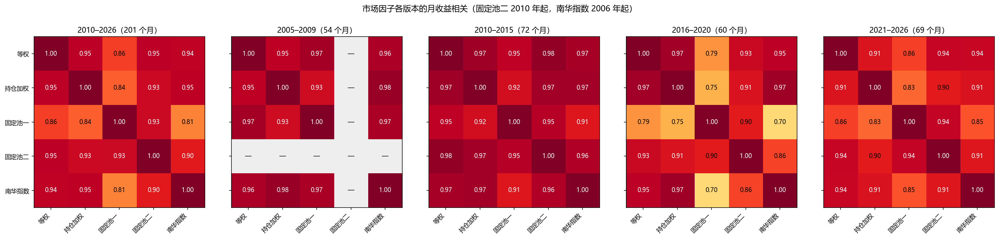

# Chinese Futures Markets: A Synthesis of Paper Replications

---

## 1. Market factors: There are common rises and falls, but simply going long does not make money.

### Conclusion
There is a common "big market" factor in China's commodity futures, which is the overall rise and fall of all commodities (Bakshi, Gao & Rossi, Management Science, 2019). It has medium strength and is not profitable for long-term holding (Fan & Zhang, Journal of Futures Markets, 2020; Bakshi, Gao & Rossi, Management Science, 2019; Szymanowska et al., Journal of Finance, 2014).

### What is it and how to build it
- **Definition**: The returns of all commodity futures are equal-weighted average every month, which is equivalent to the "big market" of the commodity market. In the paper it is called average factor AVG (Bakshi, Gao & Rossi, Management Science, 2019) or equal weighted index (Szymanowska et al., Journal of Finance, 2014).
- The following version comparison is calculated in this article, and dominant contract is used uniformly:
  - **Monthly return of a single instrument**: month-end divided by previous month-end closing price, minus 1, using a ratio-adjusted continuous dominant-contract series. The dominant contract is chosen by the previous trading day’s maximum open interest; roll adjustments remove discontinuities caused by switching contracts.
  - **instrument**: All commodity futures, excluding stock indexes and treasury bonds; new instruments will not be included until 6 months after they have been listed.

| Version | practice | Purpose |
|---|---|---|
| Equal weight (main version) | Simple average of all instruments in the month; the number of instruments increased from about 12 in 2005 to about 76 in 2026 | daily use |
| open-interest notional weighting | Weighted by open-interest notional at the end of the previous month | Closer to "money in the market" |
| Fixed pool one | 12 instruments listed before 2006, equal weights, starting from 2005 | Look before 2010; poor representation after 2016 |
| Fixed pool two | 19 instruments listed before 2010, open-interest notional median value ≥ 10 hundred million CNY since 2021, equally weighted, since 2010 | Compare different years (composition unchanged) |
| Nanhua Commodity Index | off-the-shelf index | control |

The correlation between the monthly returns of each version (calculated in this article):

- The correlation between equal weighting, open-interest weighting, fixed pool 2 and Nanhua Index in each period is basically 0.86~0.98, and can be regarded as the same factor.
- Fixed Pool 1 correlates 0.93–0.97 with the other versions before 2010. During 2016–2020, its correlations with the equal-weighted, open-interest-weighted, and Nanhua indices fall to 0.70–0.79: it excludes ferrous metals and most chemicals, which followed distinct trends during the supply-side reform.
- Therefore, to compare different years, use fixed pool two; fixed pool one can only represent the "market of old instruments".

### Why is it constructed this way and what does it represent?
- **Economic Concept Wanted to Capture**: The risk shared by the entire commodity asset class is equivalent to the "market portfolio" in stocks. Holding any commodity will expose you to this risk.
- **Why equal weighted averaging**: Commodities do not have a "market capitalization" and cannot be weighted by market capitalization like stocks. Equally weighted averaging allows the individual factors of each instrument to cancel each other out, and what remains is the common part of all instruments. The paper uses it as the first factor in the pricing model and finds that it is the first principal component of the test portfolio return (Bakshi, Gao & Rossi, Management Science, 2019).
- **Why use futures returns instead of spot price**: Futures only occupy margin, and futures returns itself is excess returns, which can directly answer the question "Is there any compensation for taking this risk?"
- **Why use dominant contract (version of this article)**: China's transactions are concentrated in dominant contracts. Near and far months are often inactive, and prices are unreliable. The paper version uses a fixed term rule (such as the second nearby contract), and the trends of the equal-weighted indexes of the two are almost the same (calculated in this article).
- **Limitations of the proxy**: Equal weighting means that unpopular small instruments have the same weight as rebar and copper; and the number of instruments increases from 12 to 76, and the composition of the "big market" is different in different years. Therefore, open-interest notional weighting and two fixed pool versions were also made for comparison.

### How strong is it?
- Across 11 test portfolios formed from carry, momentum, and sectors, the first principal component correlates 0.99 with the average factor, consistent with the paper (Bakshi, Gao & Rossi, Management Science, 2019).
- The following is the calculation for this article:
  - The first principal component of individual-instrument returns after 2015 explains about **31%** of the variance.
  - The average pairwise correlation of instruments is approximately **0.2**:
    - Within-sector correlations is about 0.3~0.47 (ferrous metals, nonferrous metals, and energy have stronger internal comovement).
    - There are only 0.1~0.2 between agricultural products and between agricultural products and other sectors; gold basically does not follow.
  - The average pairwise correlation is 0.42 during 2005–2014 and drops to 0.21 after 2015.
  - For two completely non-overlapping instruments (the old instrument pool and the new instrument), the correlation between the equal-weighted indices is still 0.7~0.9, indicating that the common factors are real and are not caused by the overlap of components.
  - The R² of a diversified combination can reach 0.7~0.9, but this is the arithmetic result of diversification and does not mean that a single instrument rises and falls very strongly at the same time.

### Only go long but don’t make money
- Average factor annualized 3.8% (t 1.12), risk premium is not significant (p = 0.28). The American sample in the paper is 6.3% (Bakshi, Gao & Rossi, Management Science, 2019).
- In the sample period of the paper, 2004–2017, Chinese commodities do multi-year 0.1% (t 0.02), which is consistent with the paper; after 2017, it is 6% (t 1.84), which is close to significance, reflecting the commodity bull market in 2020–2022 (Fan & Zhang, Journal of Futures Markets, 2020).
- The spot premium of the equal-weighted index is approximately −0.1%~−0.3%, close to 0, consistent with the paper (Szymanowska et al., Journal of Finance, 2014).
- The equal-weighted version constructed using the dominant contract has an annualized return of approximately 2.9% (t 0.98), and the open-interest weighting is approximately 5.1% (t 1.43) (calculated in this article).
- It’s not that there is no market, but that the big rises and big falls cancel each other out (calculated in this article):

| period | Equally weighted annualization |
|---|---|
| 2005–2009 | +3.8% |
| 2010–2015 | −7.8% |
| 2016–2020 | +11.4% |
| 2021–2026 | +5.8% |

- Annualized volatility is about 12%, and the standard error of the average return under 20 years of data is about ±3%, so the accurate statement is "can't tell it makes money" rather than "definitely doesn't make money."
- The meaning of the hedging perspective: On the whole, the insurance premium paid by the hedger to the speculator as mentioned by Keynes's "normal backwardation" cannot be seen.

### Market factors alone are not enough
When using only the average factor, the α of 5 test combinations is significant, and the carry and momentum factors must be added to explain the cross-sectional returns (Bakshi, Gao & Rossi, Management Science, 2019). This motivates Section 2.

### What does it follow (same period, calculated in this article)

**Table 1: Contemporaneous regression of market factors and macro variables**

**Panel A: 2005–2026 (excluding exchange rate and crude oil, the two data are shorter)**

| | (1) Equal weight | (2) Open-interest weighting | (3) Ferrous metals | (4) Non-ferrous precious metals | (5) Energy and Chemical Industry | (6) Agricultural products |
|---|---|---|---|---|---|---|
| ΔPMI (points) | 0.104 (0.71) | 0.176 (0.96) | 0.112 (1.09) | 0.180 (0.85) | 0.091 (0.26) | 0.122 (1.26) |
| ΔPPI year-on-year (percentage points) | 0.707*** (3.22) | 0.731** (2.49) | 0.919* (1.81) | 0.525* (1.80) | 1.077** (2.52) | 0.461*** (3.36) |
| ΔM1 year-on-year (percentage points) | -0.172** (-2.38) | -0.195** (-1.99) | -0.291** (-2.32) | -0.074 (-0.77) | -0.314*** (-2.63) | -0.095* (-1.67) |
| CSI 300 return (%) | 0.155*** (4.11) | 0.212*** (4.55) | 0.164** (2.34) | 0.233*** (4.32) | 0.239*** (3.56) | 0.093*** (3.22) |
| Constant | 0.088 (0.42) | 0.228 (0.89) | 0.234 (0.56) | 0.279 (0.98) | -0.033 (-0.09) | -0.043 (-0.26) |
| Number of samples (months) | 254 | 254 | 204 | 254 | 254 | 254 |
| R² | 0.174 | 0.186 | 0.067 | 0.170 | 0.144 | 0.109 |
| Adjust R² | 0.160 | 0.173 | 0.049 | 0.157 | 0.130 | 0.095 |

**Panel B: From 2018-04 (add exchange rate and crude oil)**

| | (1) Equal weight | (2) Open-interest weighting | (3) Ferrous metals | (4) Non-ferrous precious metals | (5) Energy and Chemical Industry | (6) Agricultural products |
|---|---|---|---|---|---|---|
| ΔPMI (points) | -0.054 (-0.87) | -0.088 (-1.01) | 0.002 (0.02) | -0.230* (-1.67) | -0.218*** (-3.59) | 0.104 (1.57) |
| ΔPPI year-on-year (percentage points) | 0.178 (0.73) | 0.065 (0.20) | 0.187 (0.26) | 0.098 (0.40) | -0.002 (-0.00) | 0.311* (1.65) |
| ΔM1 year-on-year (percentage points) | -0.330*** (-5.27) | -0.428*** (-4.28) | -0.678*** (-4.61) | -0.306*** (-3.11) | -0.434*** (-3.40) | -0.135* (-1.68) |
| CSI 300 return (%) | 0.074 (1.34) | 0.139* (1.88) | 0.090 (0.75) | 0.193* (1.85) | 0.067 (1.27) | 0.048 (0.99) |
| USDCNH change (%) | -0.454*** (-2.98) | -0.536*** (-3.07) | -0.630* (-1.73) | -0.389 (-1.57) | -0.836*** (-3.90) | -0.075 (-0.50) |
| SC crude oil return (%) | 0.176*** (9.12) | 0.149*** (4.46) | 0.141*** (2.74) | 0.063 (1.41) | 0.396*** (13.09) | 0.046** (2.40) |
| Constant | 0.341 (1.56) | 0.614** (2.27) | 0.831 (1.57) | 0.692** (2.06) | 0.189 (0.70) | 0.027 (0.14) |
| Number of samples (months) | 101 | 101 | 101 | 101 | 101 | 101 |
| R² | 0.490 | 0.357 | 0.141 | 0.203 | 0.686 | 0.148 |
| Adjust R² | 0.458 | 0.316 | 0.086 | 0.152 | 0.666 | 0.094 |

The explained variable is the monthly return (%) of each version of the market factor or sector equal-weighted index; the explanatory variable is the data of the same month. The Newey-West t values ​​are in parentheses; \*, \*\*, \*\*\* indicate that 10%, 5%, and 1% are significant respectively. The macro data is for the statistical month (the actual release is in the following month). Here we only look at the relationship in the same period and are not used for prediction.

- **Crude oil is the main contemporaneous correlate**: After 2018, a 1% oil price increase is associated with a 0.18% same-month increase in the equal-weighted market (t 9.1) and 0.40% in energy and chemicals (t 13.1). In Panel B, adjusted R² is 0.46 for the equal-weighted market and 0.67 for energy and chemicals. Panel A reports 0.16 for the full sample, but the sample periods differ and cannot be compared directly.
- **The stock market is significant in the full sample, but it is not significant when crude oil is added after 2018**: It shows that the stock market and commodities are linked during the same period, and part of it is that both follow crude oil and global risk sentiment.
- **Commodities fall when the RMB depreciates** (t −3.0 after 2018 years), the energy change is the most obvious.
- **PPI is only significant in the full sample**: PPI itself is the price of industrial products. It is expected that it rises and falls at the same time as commodities. It is "two measures of the same thing" and is not a cause.
- **The results of M1 are not robust**: when viewed alone, it is almost irrelevant to the market factor (correlation −0.07), and is significantly negative after being put into multivariable regression (t −5.3 after 2018 years). The conflicting results between individual and combined results may be caused by collinearity with other variables, and are not yet interpreted.
- **PMI basically irrelevant**: Not significant except for energy (after 2018 years).
- Summary: The market factor is mainly "crude oil + exchange rate + risk sentiment", not the domestic business cycle. This is only a contemporaneous relationship, the variables were selected by ourselves, and the economic implications were not further tested.

### Can it be predicted (calculated in this article)

**Table 2: Forecasted return of market factor returns next month**

**Panel A: All predictors regressed together**

| | (1) Equal weight | (2) Open-interest weighting | (3) Fixed pool one | (4) Fixed pool two |
|---|---|---|---|---|
| Market return last month (%) | 0.140* (1.69) | 0.115 (1.40) | 0.205** (2.45) | 0.181** (2.31) |
| Market returns over the past 12 months (%) | -0.016 (-0.67) | -0.010 (-0.37) | -0.032 (-1.47) | -0.027 (-0.96) |
| Overall basis (annualized %) | -0.014 (-0.30) | -0.001 (-0.01) | 0.009 (0.19) | -0.014 (-0.22) |
| Overall open-interest notional 12-month growth (%) | 0.018** (2.01) | 0.016 (1.56) | 0.022*** (2.70) | 0.025** (2.01) |
| ΔPMI (points, lagged one month) | 0.055 (0.51) | 0.075 (0.65) | 0.016 (0.17) | -0.029 (-0.35) |
| ΔPPI year-on-year (percentage points, lagged by one month) | -0.464* (-1.91) | -0.618* (-1.87) | -0.397* (-1.83) | -0.312 (-1.08) |
| ΔM1 year-on-year (percentage points, lagged by one month) | -0.030 (-0.33) | -0.009 (-0.08) | 0.023 (0.27) | -0.032 (-0.33) |
| CSI 300 return last month (%) | 0.007 (0.21) | 0.004 (0.10) | -0.001 (-0.04) | -0.054* (-1.65) |
| Constant | -0.023 (-0.10) | 0.131 (0.44) | -0.095 (-0.43) | -0.029 (-0.12) |
| Number of samples (months) | 242 | 242 | 242 | 189 |
| R² | 0.056 | 0.043 | 0.090 | 0.064 |
| Adjust R² | 0.024 | 0.010 | 0.059 | 0.022 |

**Panel B: Univariate regression one by one** (each cell is a separate regression: coefficient, (t value), [R²])

| | (1) Equal weight | (2) Open-interest weighting | (3) Fixed pool one | (4) Fixed pool two |
|---|---|---|---|---|
| Market return last month (%) | 0.171** (2.29) [2.91%] | 0.144* (1.84) [2.06%] | 0.225*** (2.85) [5.08%] | 0.161** (2.46) [2.64%] |
| Market returns over the past 12 months (%) | 0.002 (0.13) [0.01%] | -0.010 (-0.44) [0.13%] | -0.004 (-0.21) [0.02%] | 0.010 (0.54) [0.17%] |
| Overall basis (annualized %) | -0.030 (-0.58) [0.12%] | -0.030 (-0.46) [0.08%] | -0.009 (-0.18) [0.01%] | -0.015 (-0.22) [0.03%] |
| Overall open-interest notional 12-month growth (%) | 0.012* (1.66) [1.01%] | 0.008 (0.97) [0.29%] | 0.015** (2.26) [1.78%] | 0.014 (1.43) [1.14%] |
| ΔPMI (points, lagged one month) | 0.045 (0.43) [0.06%] | 0.052 (0.44) [0.05%] | 0.005 (0.05) [0.00%] | -0.045 (-0.39) [0.06%] |
| ΔPPI year-on-year (percentage points, lagged by one month) | -0.383* (-1.73) [1.17%] | -0.551** (-2.09) [1.55%] | -0.363* (-1.90) [1.20%] | -0.333 (-1.35) [0.95%] |
| ΔM1 year-on-year (percentage points, lagged by one month) | 0.011 (0.11) [0.01%] | 0.043 (0.34) [0.05%] | 0.074 (0.82) [0.28%] | -0.026 (-0.29) [0.04%] |
| CSI 300 return last month (%) | 0.032 (0.94) [0.51%] | 0.030 (0.71) [0.30%] | 0.032 (0.98) [0.60%] | -0.025 (-0.75) [0.23%] |

The explained variable is the market factor return (%) in the next month; the explanatory variables are all known at the end of the month (the macro data lags one month, so it is not released until the following month). Fixed pool two starts in year 2010 and the rest starts in year 2005. The Newey-West t values ​​are in parentheses; \*, \*\*, \*\*\* indicate that 10%, 5%, and 1% are significant respectively.

- **Last month's market return**: Univariate regression is significantly positive in all four versions (coefficients 0.14~0.23, R² 2%~5%). When regressed with other variables, it is still significant in the two fixed pool versions. That is, it rose last month and tends to continue to rise next month, but it can only explain the fluctuations of 2%~5% every month.
- **Overall open-interest notional growth**: Three versions are significant in the joint regression, and the univariate is only significant in fixed pool one, and the evidence is weak.
- **PPI rises, next month’s products are weak**: In the joint regression, most versions are significant at the 10% level, and the univariate is similar, also weak.
- **Past 12 monthly returns, overall basis, PMI, M1, CSI 300**: None have predictive power.
- This part is not subject to thesis method constraints. The variables are selected by ourselves. There is a risk of selecting variables. It is only for reference.

### What’s the use?
- **Measure risk**: For any commodity position, first look at how much exposure you have to it.
- **Distinguish between alpha and beta**: What is left after deducting it from the strategy returns is the real skill.
- Most of the long-short strategies such as carry and momentum hedge it, so the returns of these strategies are basically irrelevant to the rise and fall of the market.

---

## 2. Cross-sectional premium: carry is the core, momentum and value each have independent parts

### Conclusion
Going long and short between commodities (buy some, sell some, and hedge the market factor from Section 1), China's most stable source of income is **carry** (discount instrument outperforms premium instrument). **Cross-sectional momentum** is also very strong when viewed alone, but mostly overlaps with carry in the dominant contract. **Value** alone is ineffective or even negative, but this is because it stands on the opposite side of carry and momentum at the same time; when the three are put together, carry, momentum, and value each have independent returns, and the combination Sharpe is higher than just carrying. Skewness and position signals are either covered up by other factors in China, or the direction is opposite to overseas; other overseas signals are mostly invalid.

### Common practices
- **Cross-sectional portfolio**: Sort the instruments according to signals at the end of each month, buy the highest-signal group and sell the lowest-signal group (or weight them by ranking, total long weight is +1 and total short weight is −1), and hold for one month.
- **Why go long and short**: The rise and fall of the market on both sides of the long and short sides cancel each other out. What remains is "how much more does the instrument with this signal earn than the instrument with the low signal", which is the premium corresponding to the signal.
- **Why by ranking instead of by value**: The signal value of individual instruments in China is extreme (such as industrial silicon annualization carry −323%), and the ranking is not affected by extreme values (Koijen et al., Journal of Financial Economics, 2018).

---

### Overview

**Table 3: Long and short returns of each signal (Fan-Zhang structure, 1, 2 nearby contracts)**

| | (1) No. 1 nearby-contract 2004–2017 | (2) No. 1 nearby-contract 2017–2026 | (3) No. 2 nearby-contract 2004–2017 | (4) No. 2 nearby-contract 2017–2026 |
|---|---|---|---|---|
| term structure | 6.34 (1.28) | 4.25 (0.91) | 19.18*** (4.91) | 12.75*** (3.40) |
| momentum | 18.27*** (2.83) | 24.94*** (4.81) | 16.52*** (3.15) | 11.93** (2.35) |
| value | 1.89 (0.60) | -16.19*** (-3.21) | 0.87 (0.29) | -6.36 (-1.62) |
| Skewness | -4.75 (-1.35) | 4.21 (1.11) | 0.94 (0.27) | 6.13 (1.57) |
| Volatility | 8.74** (2.11) | -6.63 (-1.37) | 1.52 (0.40) | -2.49 (-0.71) |
| Hedging pressure | -4.62 (-0.96) | -4.75 (-1.33) | -0.95 (-0.19) | -5.53* (-1.77) |
| Position changes | -2.63 (-0.78) | 0.69 (0.26) | -4.06 (-1.40) | 3.35 (1.29) |
| Liquidity | -2.12 (-0.46) | -1.80 (-0.44) | 3.63 (0.77) | -3.65 (-0.99) |
| inflation | 10.54** (2.35) | -0.85 (-0.26) | 5.78 (1.05) | 2.60 (0.85) |
| exchange rate | -1.94 (-0.28) | -0.67 (-0.14) | -10.21 (-1.29) | 1.53 (0.44) |

Each cell is the annualized return (%) of the four-group long-short portfolio, and the Newey-West t value is in the brackets; \*, \*\*, \*\*\* respectively indicate that 10%, 5%, and 1% are significant. The exchange rate data starts from 2012 years, and the sample period of the paper only covers 27 months. Source: Fan & Zhang, Journal of Futures Markets, recurrence of 2020.

**Table 4 Spot premium and term premium grouped by variables (Szymanowska construction)**

| | (1) Spot premium n = 1 (2 months) | (2) Spot premium n = 4 (8 months) | (3) Term Premium n = 2 | (4) Term Premium n = 4 |
|---|---|---|---|---|
| Basis | -13.87*** (-5.70) | -10.67*** (-6.44) | 2.88*** (4.33) | 3.20*** (7.62) |
| momentum | 10.38*** (3.24) | 7.31*** (2.82) | -0.46 (-1.10) | -1.40* (-1.73) |
| coefficient of variation | 2.84 (0.93) | 0.95 (0.47) | -1.17** (-2.35) | -0.78 (-1.54) |
| inflation beta | 2.13 (0.77) | 3.58 (1.61) | -0.98** (-2.31) | -2.04** (-2.57) |
| dollar beta | 1.69 (0.51) | 1.98 (0.71) | 0.13 (0.34) | -0.23 (-0.39) |
| Hedging Pressure (Top-20 net shorts) | -5.52** (-2.06) | -6.67*** (-2.93) | 0.94* (1.84) | 2.01*** (4.04) |
| Total open interest | 5.73*** (2.82) | 5.24*** (3.44) | -0.97** (-2.27) | -2.01*** (-3.42) |
| Liquidity | 3.01 (1.16) | 3.49 (1.52) | -0.61 (-1.17) | -1.69** (-2.53) |

Each cell is the annualized return (%) of the highest group minus the lowest group (P4 − P1), and the Newey-West t value is in the brackets; bimonthly frequency, 2005–2026. Short Roll = Rolling to hold the nearest contract (spot premium); Excess Holding = Holding n contracts until maturity − Short Roll (term premium). \*, \*\*, \*\*\* respectively indicate that 10%, 5% and 1% are significant. Source: Szymanowska et al., Journal of Finance, reproduction of 2014.

- Only basis (term structure) and momentum are significant in both structures and two sets of samples; the value is significantly negative in out-of-sample; most of the other signals are insignificant or have unstable directions.
- In table 3, the term structure is not significant in the first nearby contract, but is very strong in the second nearby contract. The reason is that China’s first nearby contract contract is often inactive, and the price difference between the front month and the second nearby contract is noisy.

---

### 1. Carry (basis, term structure): the strongest and most stable

**How to build**

| Paper | Build |
|---|---|
| Koijen et al.，Journal of Financial Economics，2018 | At the end of each month, contracts in the delivery month and the month before delivery are eliminated; the one with the largest position is nearby-contract, and the one with the largest position further away (≥ 500 lots) is deferred-contract; carry = ln (nearby-contract price ÷ deferred-contract price) × 12 ÷ the number of months between the two (annualized, positive value = discount); main signal carry1-12 = carry in the past 12 months average; weighted by rank |
| Bakshi, Gao & Rossi，Management Science，2019 | ln(second nearby contract price ÷ first nearby contract price); the most discounted 5 units − the most premium 5 units |
| Szymanowska et al.，Journal of Finance，2014 | [ln F(1) − ln F(0)] ÷ Number of periods between two contracts; bimonthly frequency, four groups |
| Fan & Zhang，Journal of Futures Markets，2020 | ln F(1st nearby-contract) − ln F(2nd nearby-contract); four groups |

**Why is it built this way**
- The definition of carry is "the income that can be earned by holding futures assuming that the spot price remains unchanged." When nearby-contract is more expensive than deferred-contract (at a discount), if you hold deferred-contract and wait for it to become nearby contract, the price will "roll" upward. This part is carry. Therefore, the nearby–deferred contract spread is its most direct measure (Koijen et al., Journal of Financial Economics, 2018).
- **Divide by the number of months and annualize**: Different instruments have different intervals between deferred-contracts (both 1 months and 4 months), and can only be compared after annualization.
- **Take the average of the past 12 months (carry1-12)**: The term structure of instruments such as agricultural products has seasonality, and the seasonality can be removed in an average year; China's carry1-12 after 2016 is significantly better than the carry of the current month (Koijen et al., Journal of Financial Economics, 2018).
- **Exclude the delivery month and the month before delivery, and use the contract with the largest position**: Chinese individual customers must close their positions before the delivery month, and the price of the contract close to delivery will be abnormal; near-contract is often inactive, and the contract price with the largest position is more reliable.

**What economic concept does it represent**
- The basis of futures is similar to the dividend rate of stocks and the slope of the yield curve of bonds, and is a direct signal of expected returns (Szymanowska et al., Journal of Finance, 2014).
- Economic intuition (storage theory): When spot goods are in short supply and inventory is low, goods that are in use now are more valuable (convenience yield is high), nearby contract is more expensive than deferred-contract, and futures discounts are deep; when inventory is sufficient, the premium is high. Therefore, the degree of discount can be regarded as a proxy for "spot tightness".
- Looking at the returns separately, the basis mainly predicts the spot premium (the rolling return of holding a nearby-contract), and its impact on the term premium (deferred-contract relative to nearby-contract) is an order of magnitude smaller (Szymanowska et al., Journal of Finance, 2014).

**Proxy limitations in China**
- There is no reliable continuous spot price in China, and "spot" is replaced by nearby-contract futures; both nearby-contract and deferred-contract may be inactive, and there is noise in the price difference.
- When only using contracts with open interest ≥ 100 lots, the term premium drops from 2.9% to 0.8%, indicating that some deferred-contract prices are unreliable (Szymanowska et al., Journal of Finance, 2014).

**Results**
- Cross-sectional carry1-12 paper-style specification Sharpe is 0.91, and 0.71 after implementation according to realistic execution assumptions (funds of 100 million, deducting all costs), which is stronger than the overseas sample of the paper (0.65); and has almost no correlation (0.07) with time series momentum (Koijen et al., Journal of Financial Economics, 2018).
- The annualized carry factor is 15.3% (t 3.10, Sharpe 0.83), and the paper's US sample Sharpe is 0.73; it is still significant when replaced by a dominant contract (Bakshi, Gao & Rossi, Management Science, 2019).
- The term structure strategy remains significant 9 years after the paper sample, with a 2nd nearby-contract annualized rate of 12.8% (t 3.40) (Fan & Zhang, Journal of Futures Markets, 2020).
- Divided into four groups according to basis, the spot premium of low basis (concession) is 11%~14% higher per year than that of high basis (premium) (t −5.7 to −6.8), and the paper is 8%~15%; both periods of 2005–2014 and 2015–2026 are significant (Szymanowska et al., Journal of Finance, 2014).
- Summary: Four papers with different structures and different periods have the same conclusion, which is the core of China's cross-sectional premium.

---

### 2. Cross-sectional momentum: strong, but heavily overlaps with carry

**How to build**

| Paper | Build |
|---|---|
| Asness, Moskowitz & Pedersen，Journal of Finance，2013 | Past 12-month returns on the roll-adjusted continuous dominant-contract series, excluding the most recent month (MOM2–12); rank weighted |
| Bakshi, Gao & Rossi，Management Science，2019 | Rolling returns from holding nearby contracts in the past 6 months; maximum 5 − minimum 5 |
| Fan & Zhang，Journal of Futures Markets，2020 | Average monthly log return over the past 12 months; four-part grouping |
| Szymanowska et al.，Journal of Finance，2014 | Cumulative log returns from months t−12 to t−1; four-group |

**Why is it built this way**
- Looking back 6 to 12 months is standard practice in momentum research across asset classes to capture medium-term trends rather than short-term noise.
- **Exclude the most recent month**: Follow the approach of the stock literature and avoid short-term reversals within a month (Asness, Moskowitz & Pedersen, Journal of Finance, 2013).
- **Income from rolling contracts (post-reversion or rolling holding)**: This is the income that investors can actually get from holding futures, including the roll returns.

**What economic concept does it represent**
- The price does not respond enough to the information and the trend will continue for a period of time: the instrument that has risen much in the past will continue to outperform. The paper treats it as a ubiquitous phenomenon across asset classes, corresponding to value (Asness, Moskowitz & Pedersen, Journal of Finance, 2013).
- In the pricing model, the paper links the momentum factor and speculative activities (Bakshi, Gao & Rossi, Management Science, 2019), but this explanation cannot be supported in China.

**Limitations of the proxy in China: On the dominant contract, "past earnings" mainly contains carry**
- The increase in the main continuous contract includes two parts: the change in the contract price itself, and the roll returns brought about by the price difference between the old and new contracts every time the month changes. Every time the premium instrument switches to a cheaper deferred-contract, it will "earn" a little bit. This is carry.
- After taking it apart, what works on the cross-section is the roll returns (t 3.89), and the change in price itself is not significant (t 0.88) (Bakshi, Gao & Rossi, Management Science, 2019).
- Intuition: The price of instruments whose supply continues to be tight is rising, and futures are always at a discount. The discount continues to rise through the change of months, so "much higher" and "deeper discount" are often the same batch of instruments.

**Results**
- **Strong when viewed alone:**
  - Momentum factor annualized 10.3% (t 3.27), paper 11.5% (Asness, Moskowitz & Pedersen, Journal of Finance, 2013).
  - Momentum Factor Sharpe 1.06, paper 0.61 (Bakshi, Gao & Rossi, Management Science, 2019).
  - Still significant after the paper sample, first nearby-contract annualized 24.9% (t 4.81) (Fan & Zhang, Journal of Futures Markets, 2020).
  - Annualized winner-minus-loser spread 10.4% (t 3.2) grouped by momentum (Szymanowska et al., Journal of Finance, 2014).
- **But overlaps with carry:**
  - Under the paper method (second nearby contract), after momentum control carry, there is still an independent return of 14.0% (t 3.11); on the dominant contract, only 1.1% (t 0.29) is left, almost all of which is absorbed by carry (Bakshi, Gao & Rossi, Management Science, 2019).
  - Momentum is related to carry 0.52. After controlling for carry, only 3.5% (t 1.23) remains, which is not significant (Asness, Moskowitz & Pedersen, Journal of Finance, 2013).

**Table 5　Interpretation of carry and momentum (Bakshi-Gao-Rossi structure)**

| | (1) Momentum times nearby-contract (thesis method) | (2) carry times nearby-contract (thesis method) | (3) Momentum dominant contract | (4) carry dominant contract |
|---|---|---|---|---|
| α (annualized %) | 14.02*** (3.11) | 6.33* (1.77) | 1.14 (0.29) | 8.83** (2.55) |
| Average factor AVG | 0.065 (0.51) | 0.407*** (3.09) | -0.039 (-0.31) | 0.464*** (3.86) |
| carry factor | 0.479*** (5.39) |  | 0.468*** (3.25) |  |
| Momentum factor |  | 0.341*** (5.19) |  | 0.296*** (3.37) |
| Number of samples (months) | 218 | 218 | 240 | 240 |
| R² | 0.192 | 0.265 | 0.153 | 0.266 |
| Adjust R² | 0.185 | 0.258 | 0.146 | 0.260 |

The explained variable is the monthly return of the factor; α is the annualized %. Carry factor = the highest discount 5 units − the highest premium 5 units, momentum factor = the highest monthly return of 6 units in the past 5 units − the lowest 5 units, AVG = all instruments are equally weighted and long. The Newey-West t values ​​are in parentheses; \*, \*\*, \*\*\* indicate that 10%, 5%, and 1% are significant respectively. Source: Bakshi, Gao & Rossi, Management Science, Reproduction of 2019.

**Table 6 dominant contract 12 monthly increase split**

| | (1) Next month’s income |
|---|---|
| Price changes (not reinstated) | 0.125 (0.88) |
| Monthly roll returns | 0.467*** (3.89) |
| current carry | 0.049 (0.53) |

Perform a cross-sectional regression on the next month's earnings every month, and then take the time series average (Fama-MacBeth) of the coefficients; the explanatory variables are all standardized, and the coefficient = the next month's earnings (%) corresponding to every 1 standard deviation. Three variables are entered into the regression simultaneously. Source: Bakshi, Gao & Rossi, Management Science, reproduction of 2019 (dominant contract extension).

- Table 5: Under the second nearby contract caliber, after momentum control carry, there is still 14.0%’s α; under the dominant contract caliber, only 1.1% remains, and the carry’s α remains significant.
- Table 6: What matters on the cross-section is the monthly roll returns (i.e. carry), and the change in price itself is not significant.

**basis momentum (variant of momentum)**
- **Construction**: The rolling return of the front-month contract in the past 12 months − The rolling return of the second front-month contract in the past 12 months; the contracts are sorted by "delivery month ≥ current month + 2" and take the 1, 2 (Boons & Prado, Journal of Finance, 2019).
- **Why it is constructed this way**: The difference in the returns of the two curves reflects the change in the shape of the term structure (how much steeper the near end is compared to the far end, how the slope changes), not the overall price level.
- **What it stands for**: The paper believes that it compensates speculators and intermediaries for the risks they take in times of high volatility and illiquidity, rather than inventory or hedging pressure (Boons & Prado, Journal of Finance, 2019).
- **Result**: Annualized 13.1% (t 3.16), paper 18.4%; but it is not significant after controlling the three factors (including momentum). The paper believes that basis momentum absorbs momentum, and the opposite is true for China (Boons & Prado, Journal of Finance, 2019).

**Table 7 Pooled regression of basis momentum (Boons-Prado construction)**

| | (1) nearby-contract income | (2) nearby-contract income | (3) nearby-contract income | (4) nearby-contract income | (5) nearby-contract income | (6) nearby-contract income | (7) nearby-contract income |
|---|---|---|---|---|---|---|---|
| basis momentum | 3.643*** (3.38) | 3.177*** (3.36) | 2.465** (2.16) | 1.862* (1.88) |  |  | 1.741 (1.01) |
| Basis |  |  |  |  | 2.486 (0.47) |  | 4.586 (0.82) |
| Momentum (nearby-contract 12 months) |  |  |  |  |  | 0.519 (0.69) | 0.226 (0.21) |
| time fixed effects | No | Yes | No | Yes | Yes | Yes | Yes |
| instrument fixed effects | No | No | Yes | Yes | Yes | Yes | Yes |
| Number of observations (instrument-month) | 5766 | 5766 | 5766 | 5766 | 5766 | 5766 | 5766 |
| R² | 0.004 | 0.226 | 0.028 | 0.248 | 0.247 | 0.247 | 0.248 |

The explained variable is the return of the nearby contract next month (%), and the explanatory variable is the original value of the characteristics at the end of the previous month (difference in return, basis, unstandardized), the same as Table II of the paper. In parentheses are the t values ​​clustered by month; \*, \*\*, \*\*\* indicate that 10%, 5%, and 1% are significant respectively. Source: Boons & Prado, Journal of Finance, recurrence of 2019 (paper-style specification, contract position ≥ 100 lots).

- Looking at basis momentum alone, it is significant (column 1 t 3.38). After controlling time and instrument fixed effects, it is only significant at the 10% level (column 4). It is not significant after adding basis and momentum (column 7).

---

### 3. Value: Invalid alone, independent when combined with momentum

**How to build**
- ln(4.5–5.5’s average spot price ÷ the most recent spot price); the spot price is approximated by the non-rerighted dominant contract price; weighted by ranking (Asness, Moskowitz & Pedersen, Journal of Finance, 2013).
- Fan & Zhang's version uses the average price of 3.5–4.5 years ago (Fan & Zhang, Journal of Futures Markets, 2020).

**Why is it built this way**
- Commodities have no "fundamentals" such as book value and profitability. The paper instead uses prices long ago as the anchor of long-term value: it is much cheaper now than 5 years ago, even if it is "cheap" (Asness, Moskowitz & Pedersen, Journal of Finance, 2013).
- **Take 4.5–5.5 years ago**: Stay away from the lookback period of momentum (the past 1 years) to avoid overlapping of two signals; take the average price of one year to reduce the noise at a single point in time.

**What economic concept does it represent**
- Prices will return to the mean after long-term deviations: for commodities that have fallen for many years, supply will shrink and prices will move back. It is naturally opposite to the direction of momentum, so the paper studies the two together (Asness, Moskowitz & Pedersen, Journal of Finance, 2013).

**Proxy limitations in China**
- It requires 5.5 years of history, the sample only starts in 2010 years, and the median instrument is about 30 years.
- Use the unrestored main price as "spot", and the price is not completely comparable when the instrument spans multiple contracts.
- The direction of value and carry is opposite (related to −0.43): instruments that have fallen much in the long term are often rising in price, and the value signal contains the element of "short carry".

**Results**
- Annualized value factor −1.0%, the paper is +7.3% (Asness, Moskowitz & Pedersen, Journal of Finance, 2013).
- is significantly negative after the paper sample, 1 nearby-contract −16.2%(t −3.21) (Fan & Zhang, Journal of Futures Markets, 2020).
- Value has a correlation with momentum of −0.59 (paper −0.46), a half-and-half Sharpe of 0.78 (paper 0.77), still 3.9% after controlling for carry (t 3.09), and a correlation with carry of only 0.16 (Asness, Moskowitz & Pedersen, Journal of Finance, 2013).

**Table 8: Value, Momentum, and Carry (Asness-Moskowitz-Pedersen Construction)**

| | (1) Momentum | (2) Momentum | (3) Value | (4) Value | (5) Value + Momentum half and half | (6) Value + Momentum half and half |
|---|---|---|---|---|---|---|
| α (annualized %) | 9.63*** (3.23) | 3.49 (1.23) | -1.35 (-0.50) | 4.35 (1.56) | 4.14*** (2.97) | 3.92*** (3.09) |
| Equally weighted basket of goods | 0.207 (1.51) | -0.042 (-0.41) | 0.101 (0.81) | 0.332*** (3.25) | 0.154** (2.50) | 0.145** (2.41) |
| carry1-12 factors |  | 0.594*** (5.37) |  | -0.551*** (-6.17) |  | 0.021 (0.40) |
| Number of samples (months) | 194 | 194 | 194 | 194 | 194 | 194 |
| R² | 0.034 | 0.270 | 0.011 | 0.278 | 0.096 | 0.098 |
| Adjust R² | 0.029 | 0.262 | 0.006 | 0.271 | 0.091 | 0.088 |

The explained variable is the monthly return of factors weighted by ranking (1 yuan each for long and short); carry1-12 factor = average carry in the past 12 months, weighted by ranking, in the same instrument pool as value and momentum; α is the annualized %. 2010-07 to 2026-08. The Newey-West t values ​​are in parentheses; \*, \*\*, \*\*\* represent 10%, 5%, and 1% significance respectively. Source: Reproduction of Asness, Moskowitz & Pedersen, Journal of Finance, 2013 (commodities section only).

- The coefficient of momentum on carry is 0.59 (t 5.37), and after controlling, α drops to 3.49%, which is not significant.
- The coefficient of value on carry −0.55 (t −6.17): value is negative mainly because it is in the opposite direction to carry; after controlling for carry, the α of value is +4.35% (t 1.56), which is no longer negative, but not significant either.
- After controlling carry and momentum simultaneously under a unified framework, the α of value is +5.7% (t 2.48), see section 8 in this section: The value is negative mainly because it stands on the opposite side of carry and momentum at the same time.
- The coefficients of the half value + half momentum combination on carry are only 0.02, α 3.92% (t 3.09), and are basically not affected by carry.

---

### 4. Skewness: Covered by the momentum, the direction is unstable

**How to build**
- The skewness of the daily log return in the past 12 months (at least 150 trading days); the contract takes the first contract with delivery month ≥ current month + 2.
- Five groups, the group with the lowest long skewness (left skew) and the highest short skewness (right skew), held for one month (Fernandez-Perez et al., Journal of Banking & Finance, 2018).

**Why is it built this way**
- Skewness measures whether the return distribution "occasionally rises sharply" (right-skewed) or "occasionally drops sharply" (left-skewed). It requires more daily data to estimate stability, so a year's daily returns are used.

**What economic concept does it represent**
- Lottery preference: Investors (including selective hedging industry clients) like right-biased assets that occasionally rise sharply and are willing to pay more for them, resulting in such assets being overvalued and future returns low (Fernandez-Perez et al., Journal of Banking & Finance, 2018).

**Proxy limitations in China**
- In China, right-skewed instruments happen to be winners in the past: the daily return distribution of instruments that have surged in the past year is naturally right-skewed. So the skewness signal has momentum mixed in, and in the opposite direction.

**Results**
- Annualized −1.5% (t −0.78) according to the paper method, the paper is +8.0% (t 3.83) (Fernandez-Perez et al., Journal of Banking & Finance, 2018).
- After excluding factors such as momentum, there is 4.7% (t 2.54), but it is not strong by itself (Fernandez-Perez et al., Journal of Banking & Finance, 2018).
- The direction of the skewness premium reverses around 2016–2018: before, you make money by going long with negative skewness, and then you make money by going long with positive skewness (calculated in this article, supplementary test in skewness recurrence; Fan & Zhang, Journal of Futures Markets, the out-of-sample part of 2020 also has the skewness turning positive).

**Table 9 Fama-MacBeth Test of Skewness (Constructed by Fernandez-Perez et al.)**

| | (1) Benchmark three factors | (2) Three factors + skewness |
|---|---|---|
| Constant | -0.585 (-0.27) | 0.521 (0.25) |
| Equal weight EW | 1.595 (0.58) | 0.489 (0.18) |
| term structure TS | 5.248*** (3.23) | 5.259*** (3.12) |
| Momentum MOM | 6.320*** (3.12) | 6.175*** (3.04) |
| Skewness SKEW |  | -0.254 (-0.16) |
| Number of samples (months) | 239 | 239 |
| Average cross-section R² | 0.383 | 0.453 |

Two-step method Fama-MacBeth: first estimate the β of each portfolio on the factor, and then perform cross-sectional regression every month. The table shows the time series average of the risk price λ (annualized %). The Newey-West t values ​​are in parentheses; \*, \*\*, \*\*\* indicate that 10%, 5%, and 1% are significant respectively. Source: Fernandez-Perez et al., Journal of Banking & Finance, replication of 2018.

- The risk price of term structure and momentum is significant, but the risk price of skewness is not significant after adding skewness (t −0.16). The skewness in the paper is significantly positive.

---

### 5. Position signal: There is information, but the direction is opposite to overseas

**How to build**

| Paper | Build |
|---|---|
| Kang, Rouwenhorst & Tang，Journal of Finance，2020 | The long and short positions of the top 20 members announced by the exchange every day are the same as the sum of all contracts in the instrument; calculated on the last trading day of each week. Q = Weekly change in net long positions of large investors ÷ Total open interest last week (required total positions last week ≥ 1000 lots); HP̄ = 52-week average of net short positions in large investors ÷ Total open interest in the current week |
| Szymanowska et al.，Journal of Finance，2014 | Top 20 members (short − long) ÷ (short + long), instead of CFTC hedging pressure |
| Fan & Zhang，Journal of Futures Markets，2020 | Hedging ratio = current month \|Position changes\| ÷ Trading volume for the month |

**Why is it built this way**
- The original paper uses the US CFTC weekly report, which divides traders into commercial (hedgers) and non-commercial (speculators). China does not have this kind of classified data. The exchange only publishes the positions of the top 20 members, which can only be replaced by "large members as a whole" (Kang, Rouwenhorst & Tang, Journal of Finance, 2020).
- **Q uses weekly changes**: Capture the short-term trading direction, that is, who is eager to buy and who is eager to sell.
- **HP̄ Use 52 Weekly Average**: Smooth out short-term trades, leaving long-term positions.
- **Fan & Zhang's hedging ratio**: Hedging positions are relatively stable and speculators trade frequently, so the greater the position change relative to the trading volume, the more hedging activities are considered. The paper itself admits that this is only a crude proxy.

**What economic concept does it represent**
- In the paper there are two kinds of premiums (Kang, Rouwenhorst & Tang, Journal of Finance, 2020):
  - **Short-term liquidity premium (Q)**: Speculators trade with the trend and are eager to close transactions, requiring others to provide liquidity; the instruments they buy will earn lower returns, and the hedgers who provide liquidity make this money.
  - **Long-term Hedging Premium (HP̄)**: The more net short the hedger is, the more "insurance premium" he needs to pay to speculators, and the higher the future income will be (Keynes's normal backwardation theory).

**Proxy limitations in China**
- The first 20 members are futures companies, which are mixed with hedgers and speculators, and the members will change every week; it represents "large traders vs. other traders", not "hedging vs. speculation". Therefore, the results can only be explained by the difference between large investors and retail investors.

**Results**
- The top 20 large traders followed the trend, and the price continued to rise after buying: divided into five groups according to net buying, the highest group rose 0.20% more than the lowest group on the next 5–10 days (t 3.37), without reversal. In the paper, speculators pay to hedgers; in China, it is more like large investors who have better information, and those who pay are mainly retail traders outside the top 20. This effect is concentrated before 2016 (Kang, Rouwenhorst & Tang, Journal of Finance, 2020).
- The more large investors are net short, the lower the returns two weeks later (t −2.25), which is opposite to the direction of "hedgers pay insurance premiums" in the paper (Kang, Rouwenhorst & Tang, Journal of Finance, 2020).
- The greater the top 20 headroom, the lower the backwardation (annualized −5.5%, t −2.1), in the opposite direction to the paper (Szymanowska et al., Journal of Finance, 2014).
- The direction of the hedging ratio is also opposite to the paper (Fan & Zhang, Journal of Futures Markets, 2020).

**Table 10: Large trades and subsequent returns (Kang-Rouwenhorst-Tang construction)**

| | (1) Revenue of week t+1 | (2) Revenue of week t+1 | (3) Revenue of week t+2 | (4) Revenue of week t+2 | (5) Revenue of week t+1 | (6) Revenue of week t+2 |
|---|---|---|---|---|---|---|
| Large investors are net buying Q | 1.661*** (3.40) | 0.960* (1.80) | 0.766 (1.39) | 0.219 (0.40) | 0.847 (1.48) | 0.516 (0.84) |
| Large traders are net short in the long term HP̄ |  |  |  |  | -0.187 (-0.77) | -0.566** (-2.54) |
| Basis |  | -0.448** (-1.97) |  | -0.667*** (-2.60) | -0.564** (-2.27) | -0.666** (-2.33) |
| S × idiosyncratic fluctuation |  | 0.233 (1.44) |  | 0.105 (0.67) | 0.305* (1.74) | 0.005 (0.03) |
| Income for the week R_t |  | 2.180* (1.88) |  | 2.808** (2.34) | 0.824 (0.74) | 3.001** (2.42) |
| Constant | 0.028 (0.45) | 0.076 (1.37) | 0.050 (0.80) | 0.110** (2.01) | 0.057 (1.00) | 0.120** (2.07) |
| Number of samples (weeks) | 997 | 972 | 996 | 971 | 946 | 945 |
| Average cross-section R² | 0.048 | 0.261 | 0.043 | 0.252 | 0.294 | 0.290 |

Each week, cross-sectional regressions predict next-week (or second-week-ahead) returns (%); coefficients are then averaged over time (Fama–MacBeth). Q is the weekly change in top-20 member net longs divided by last week’s total open interest. HP̄ is the 52-week average of top-20 member net shorts divided by current-week total open interest. Parentheses contain Newey–West t-statistics; \*, \*\*, and \*\*\* denote significance at 10%, 5%, and 1%. Source: replication of Kang, Rouwenhorst & Tang, Journal of Finance, 2020.

- The coefficient of Q for large investors' net buying is positive (column 1 t 3.40): the instrument bought by large investors will continue to rise next week. In the paper, speculators have negative returns after buying. After adding control variables, it weakens to the 10% level.
- The coefficient on HP̄, the long-term net short position of large investors, is negative (column 6 t −2.54): the greater the net short position of large investors, the lower the return in the second week. In the paper, the more headroom a hedger has, the higher his returns will be.

---

### 6. Basically invalid

| signal | How to build | Economic concept that wants to be represented | China results | Source |
|---|---|---|---|---|
| coefficient of variation | Variance of returns over the past 36 months ÷ mean | Volatility risk: high risk, high return; dividing by mean is to remove the impact of momentum | Not significant, the paper is significant | Szymanowska et al.，Journal of Finance，2014 |
| Volatility | Variance of daily returns over the past 36 months ÷ \|mean\| | Same as above | The paper is positive during the sample period and then reverses | Fan & Zhang，Journal of Futures Markets，2020 |
| inflation beta | Rolling regression coefficient of monthly earnings on month-on-month change in CPI over the past 60 months (Fan & Zhang used 42 months) | Investors are willing to pay less for commodities that hedge against inflation | Not significant (inflation is roughly proxied by CPI, without adjustment for expectations) | Szymanowska et al.，Journal of Finance，2014；Fan & Zhang，Journal of Futures Markets，2020 |
| dollar beta | Rolling regression coefficients of monthly returns on exchange rate changes; using USDCNH instead of US dollar index, since 2012 | Exchange rate risk exposure | Not significant (short sample) | Szymanowska et al.，Journal of Finance，2014；Fan & Zhang，Journal of Futures Markets，2020 |
| Liquidity | Amivest: Average daily trading volume in the past two months ÷ \|Earnings\| | Illiquid instruments should have a liquidity premium | Not significant | Szymanowska et al.，Journal of Finance，2014；Fan & Zhang，Journal of Futures Markets，2020 |
| Position changes | Changes in total instrument holdings | Increased positioning reflects demand and prosperity | Not significant | Fan & Zhang，Journal of Futures Markets，2020 |

---

### 7. Pricing model: requires three factors: market + carry + momentum
- The three-factor model of average factor, carry, and momentum can explain the cross-sectional returns of Chinese commodities; if any one of carry or momentum is removed, the model is rejected (Bakshi, Gao & Rossi, Management Science, 2019).
- But the economic explanation given in the paper (carry corresponds to stock market volatility risk, momentum corresponds to speculative activities) cannot be supported in China (Bakshi, Gao & Rossi, Management Science, 2019).
- A single basis factor cannot explain China's backwardation grouped by basis, which is different from the paper (Szymanowska et al., Journal of Finance, 2014).

### 8. Overlap of carry, momentum, and value (calculated in this article)

**Why do it**
- The previous parts come from different papers. The instrument pool, contract selection, and construction methods are all different. It is impossible to directly compare the overlap between the three. Here we put them into the same frame.

**How to build**
- Following the instrument pool reproduced by Asness-Moskowitz-Pedersen (average daily trading volume of the main 60 ≥ 1000 lots, listing time ≥ 60 days, excluding CFFEX) and portfolio structure (weighted by signal ranking at the end of each month, long and short 1 yuan each, held for the next month, return to the dominant contract after restoration). The momentum and value factors here are exactly the same as the recurring factors (correlated 1.00).
- Four signals: carry1-12 (average annualized carry in the past 12 months), current month carry, momentum (revenue in the past 12 months, excluding the most recent 1 months), value (ln(4.5–5.5 average price a year ago ÷ current price)).
- Common samples 2010-07 to 2026-08 (value requires approximately 5 years of history), 194 months; excluding transaction costs.

**Table 11　Correlation coefficients of carry, momentum, and value**

| | (1) carry1-12 | (2) Carry this month | (3) Momentum | (4) Value | (5) Equally weighted commodity basket |
|---|---|---|---|---|---|
| carry1-12 | 1.00 | 0.75 | 0.52 | -0.43 | 0.42 |
| carry this month |  | 1.00 | 0.61 | -0.43 | 0.37 |
| momentum |  |  | 1.00 | -0.56 | 0.18 |
| value |  |  |  | 1.00 | 0.10 |
| Equally weighted basket of goods |  |  |  |  | 1.00 |

Correlation coefficient of monthly factor returns, 2010-07 to 2026-08 (194 months). This article calculates.

| | (1) carry1-12 | (2) Carry this month | (3) Momentum | (4) Value | (5) Equally weighted commodity basket |
|---|---|---|---|---|---|
| 2010–2015：carry1-12 | 1.00 | 0.78 | 0.45 | -0.27 | 0.35 |
| 2010–2015: Carry of the month |  | 1.00 | 0.51 | -0.25 | 0.32 |
| 2010–2015: Momentum |  |  | 1.00 | -0.49 | -0.02 |
| 2010–2015: Value |  |  |  | 1.00 | 0.32 |
| 2010–2015: Equally weighted basket of goods |  |  |  |  | 1.00 |
| 2016–2026：carry1-12 | 1.00 | 0.74 | 0.54 | -0.47 | 0.44 |
| 2016–2026: Carry of the month |  | 1.00 | 0.64 | -0.48 | 0.41 |
| 2016–2026: Momentum |  |  | 1.00 | -0.58 | 0.25 |
| 2016–2026: Value |  |  |  | 1.00 | 0.04 |
| 2016–2026: Equally weighted basket of goods |  |  |  |  | 1.00 |

Correlation coefficient for segments (66 months 2010–2015, 128 months 2016–2026). This article calculates.

**Table 12 Interpretation: regression of each factor on the remaining factors**

| | (1) Momentum | (2) Momentum | (3) Value | (4) Value | (5) carry1-12 | (6) carry1-12 | (7) Carry this month |
|---|---|---|---|---|---|---|---|
| α (annualized %) | 3.49 (1.23) | 5.75** (2.55) | 4.35 (1.56) | 5.71** (2.48) | 6.39*** (2.59) | 7.60*** (3.20) | 0.82 (0.39) |
| Equally weighted basket of goods | -0.042 (-0.41) | 0.130 (1.45) | 0.332*** (3.25) | 0.316*** (3.22) | 0.334*** (3.38) | 0.403*** (4.31) | 0.095* (1.71) |
| carry1-12 | 0.594*** (5.37) | 0.307** (2.56) | -0.551*** (-6.17) | -0.319*** (-3.76) |  |  | 0.547*** (6.22) |
| momentum |  |  |  | -0.390*** (-5.35) | 0.411*** (4.58) | 0.239** (2.19) | 0.255*** (4.03) |
| value |  | -0.519*** (-5.67) |  |  |  | -0.330*** (-3.94) | -0.052 (-0.59) |
| Number of samples (months) | 194 | 194 | 194 | 194 | 194 | 194 | 194 |
| R² | 0.270 | 0.418 | 0.278 | 0.424 | 0.375 | 0.441 | 0.632 |

The explained variable is the monthly return of each factor; α is the annualized %. The Newey-West t values ​​are in parentheses; \*, \*\*, \*\*\* represent 10%, 5%, and 1% significance respectively. 2010-07 to 2026-08. This article calculates.

**Table 13: α after controlling for the remaining two factors: segmentation**

| | (1) 2010–2026 | (2) 2010–2015 | (3) 2016–2026 |
|---|---|---|---|
| Momentum: α after controlling for the other two factors and the basket | 5.75** (2.55) | 5.59 (1.19) | 4.68* (1.72) |
| Value: α after controlling for the other two factors and the basket | 5.71** (2.48) | 8.63** (2.27) | 4.02 (1.52) |
| carry1-12: α after controlling the other two factors and the basket | 7.60*** (3.20) | 11.11*** (3.41) | 5.45* (1.95) |

α is the annualized %, and the Newey-West t value is in the parentheses; \*, \*\*, \*\*\* represent 10%, 5%, and 1% significance respectively. This article calculates.

**Table 14: Combined performance**

| | (1) 2010–2026 Annualized % | (2) 2010–2026 Sharpe | (3) 2010–2015 Annualized % | (4) 2010–2015 Sharpe | (5) 2016–2026 Annualized % | (6) 2016–2026 Sharpe |
|---|---|---|---|---|---|---|
| carry1-12 | 12.00*** (4.13) | 0.97 | 11.97*** (2.61) | 1.27 | 12.01*** (3.26) | 0.87 |
| momentum | 9.48*** (3.27) | 0.76 | 9.63** (2.18) | 1.02 | 9.40** (2.50) | 0.68 |
| value | -1.07 (-0.36) | -0.09 | -0.42 (-0.11) | -0.04 | -1.40 (-0.35) | -0.10 |
| carry + momentum | 10.74*** (4.30) | 0.99 | 10.80*** (2.73) | 1.35 | 10.71*** (3.38) | 0.89 |
| carry + value | 5.47*** (3.35) | 0.82 | 5.78** (2.40) | 0.98 | 5.30** (2.52) | 0.75 |
| Momentum + Value | 4.21*** (2.72) | 0.72 | 4.61** (2.01) | 0.94 | 4.00* (1.95) | 0.64 |
| carry + momentum + value | 6.80*** (4.62) | 1.14 | 7.06*** (2.95) | 1.45 | 6.67*** (3.61) | 1.03 |

Each factor is first scaled to the same fluctuation according to the full sample fluctuation, and then added up with equal weights; scaling is post hoc and is only used to compare dispersion effects and is not an executable strategy. No matter the cost. The Newey-West t values ​​are in parentheses; \*, \*\*, \*\*\* represent 10%, 5%, and 1% significance respectively. This article calculates.

**Conclusion**
- **carry is independent core**: after controlling for both momentum and value, α remains 7.6% (t 3.20) (Table 12, column 6). Monthly carry is fully explained by carry1-12 and momentum (α 0.8%, t 0.39) and does not need to be looked at separately.
- **Momentum and value are both absorbed by carry when viewed individually, and each has an independent part when the three are together**: Momentum only controls carry when α 3.5% (t 1.23), and then controls value to be 5.8% (t 2.55); value only controls carry when 4.4% (t 1.56), and then controls momentum to 5.7%(t 2.48). The reason is that value and momentum are strongly negatively correlated (−0.56), and when viewed individually, the other's components mask their own returns.
- **China's value is negative because it is on the opposite side of both carry and momentum** (coefficients −0.32 for carry, −0.39 for momentum). After deducting these two parts, the value itself is positive and the direction is consistent with overseas.
- **The combination of the three is sharp 1.14, which is higher than just carrying (0.97)**; the momentum added by carry is only 0.99, which is almost no improvement because the two overlap too much. Improvements mostly come from adding value.
- **After 2016 years, the independent α of the three become weaker** (t 1.5~1.95), and the combined sharpness drops from 1.45 to 1.03.
- Limitations: No cost is considered; the scaling of the portfolio is ex post facto; the cost of turnover and turnover of value and momentum is not measured.

---

## 3. Sequential timing: The timing evidence of a single instrument is weak, and the term structure signal is stronger than the price signal.

### Conclusion
Timing is based on looking at an instrument (or commodity as a whole)'s own past information to decide whether to go long or short next, without comparing it with other instruments. China’s evidence is:
- **Price timing in the past (time series momentum)** exists but is weak, and is not significant after deducting costs; after excluding the difference in long-term averages between instruments, the evidence that "the same instrument has risen in the past and will continue to rise in the future" disappears.
- **Timing based on term structure (timing carry)** is stronger than based on price, which is consistent with "carry is the core" on the cross-section.
- **Forecast the overall income of commodities based on positions and basis** The direction is consistent with overseas but weaker, and the basis is more stable.
- **Intraday** has a continuation (the late trading follows the opening and the penultimate half-hour), but the range is too small, and most of the goods are not enough after deducting the cost.

### Common practices
- **Timing strategy**: Each instrument only looks at its own signal. If the signal is positive, go long, if the signal is negative, go short. There is no comparison between different instruments, so the number of longs and shorts is not necessarily equal, and the combination will expose the direction of the market.
- **The difference between **and cross-section**: The cross-section strategy hedges the market and earns from the "relative strength between instruments"; the time series strategy earns from "each instrument's own rise and fall direction".
- **Testing method**: One is to directly look at the strategy returns (Sharpe, t value); the other is to predict regression, where the next period's returns are regressed on the current period's signal to see if the coefficient is significant.

---

### 1. Time series momentum: exists, but is not significant after deducting costs

**How to build**
- At the end of each month, look at the cumulative return of each instrument in the past 12 months, which is positive for long and negative for short; position = 40% ÷ annualized volatility of the instrument (daily return index weighted, center quality 60 days); instruments can be traded in the current month with equal weight, holding 1 months (Moskowitz, Ooi & Pedersen, Journal of Financial Economics, 2012).
- The income is based on the roll-adjusted restoration price of the main continuous contract; instruments include commodities, stock indexes, and treasury bond futures.

**Why is it built this way**
- Looking back at 12 months is the benchmark of the paper; allocate positions according to the reciprocal of volatility, so that each instrument contributes similar risks and avoids high-volatility instruments dominating the portfolio.
- Only look at your own past and do not compare with other instruments, so you can go long or short as a whole when all instruments rise and fall at the same time.

**What economic concept does it represent**
- Prices first underreact to information and then overreact, forming a trend that lasts for a period of time. The paper also found that it makes money when the market rises and falls (the returns are "smiling" to the market) and can hedge against extreme market conditions (Moskowitz, Ooi & Pedersen, Journal of Financial Economics, 2012).

**Proxy limitations in China**
- The paper uses 58 futures around the world (including foreign exchange), and China only has local instruments, mainly commodities; the increase in the roll-adjusted price includes the monthly roll returns, that is, the carry component (see Section 2).

**Results**

**Table 15 Performance of Time Series Momentum**

| | (1) Annualized return | (2) Sharpe | (3) t | (4) Maximum drawdown | (5) Since 2010 Annualized / Sharpe | (6) From 2016 Annualized / Sharpe |
|---|---|---|---|---|---|---|
| Paper-style specification (no cost deduction, closing transaction at the end of the month) | 9.2% | 0.61 | 2.76*** | −40.9% | 9.6% / 0.67 | 6.3% / 0.53 |
| Realistic execution assumptions (100 million capital, VWAP the next day, all costs deducted) | 4.5% | 0.31 | 1.40 | −43.2% | — / 0.39 | — / 0.24 |
| Realistic execution assumptions, capital 10 million | 5.7% | 0.37 |  |  |  |  |
| Realistic execution assumptions, capital 1 billion | 2.5% | 0.20 |  |  |  |  |
| Contrast: Always go long |  | 0.17 |  |  |  |  |

Look back 12 months; position = 40% ÷ annualized volatility, equal weight of tradable instruments in the current month; 2006-01 to 2026-09, including commodities, stock indexes, and treasury bond futures. Annualized execution costs are 2.12%, of which the contract rolling is 1.48%. Asterisks for t-values ​​are \*, \*\*, \*\*\* indicating 10%, 5%, and 1% significance respectively. Source: Replication in Moskowitz, Ooi & Pedersen, Journal of Financial Economics, 2012 (numbers taken from replication report).

- The Sharpe of the paper's caliber is 0.61 (t 2.76), which is greater than 1 if it is weaker than the paper; it drops to 0.31 (t 1.40) after implementation according to the realistic execution assumptions, which is not significant; after 2016, it is only 0.24. About half of the Sharpe is eaten up by transaction timing, shock costs and month-to-month costs (Moskowitz, Ooi & Pedersen, Journal of Financial Economics, 2012).
- Consistent with the thesis: the return is not correlated with "always long" (the latter's Sharpe is only 0.17), the smile formation is established (t 3.30), and the real version still earned 10% and 35% respectively during the crashes in 2008 and 2014.
- Different from the paper: China's trend is shorter, and the Sharpe looking back 1~9 months (0.74~0.77) is better than 12 months (0.61).

---

### 2. Does time series momentum really exist: it disappears after excluding instrument differences.

**How to build**
- **Instrument-by-instrument regression**: Next month's income r(t+1) is regressed on the past 12 months' income to see if each instrument has its own predictability.
- **Hybrid Regression**: All instruments are stacked together, and r(t+1)/σ(t) is regressed on the returns in the past 12 months; instrument fixed effects are then added for comparison.
- **TSH comparison**: Go long and short based on the cumulative return (historical average) of the instrument since its listing, without any predictability (Huang, Li, Wang & Zhou, Journal of Financial Economics, 2020).

**Why is it built this way**
- When pooled regression stacks all instruments together, if the long-term average returns of each instrument are different, "the instrument that has risen more in the past will also rise more in the future" may just be because it is an instrument with a high long-term average, rather than the same instrument itself having a trend. Adding instrument fixed effects means removing this part of the long-term mean difference.
- TSH is a strategy that only exploits "long-term mean differences". If TSM and TSH make the same amount of money, it means that TSM's earnings do not come from timing.

**What economic concept does it represent**
- Distinguish between two completely different things: **True time series predictability** (the same instrument has risen in the past and is more likely to rise in the future) and **Mean difference on the cross-section** (Some instruments are better than others in the long run). The former is "timing".

**Proxy limitations in China**
- China’s instrument history is relatively short (mostly 10 to 20 years), and the test power of instrument-by-instrument regression is very low.
- The bootstrap method of paper resampling observation by observation destroys the correlation between instruments in the same month, and the critical value is raised (the critical value of the paper-style specification is about 7.3, and the resampling of the entire month is about 2.0). In the reoccurrence, it will be changed to re-drawing the whole block on a monthly basis.

**Results**
- Instrument-by-instrument regression: Only 2 of the 58 instruments are significantly positive at the 10% level, and 33 have negative slopes; the out-of-sample median R² is −0.82% (Huang, Li, Wang & Zhou, Journal of Financial Economics, 2020).

**Table 16: Pooled regression of time series momentum**

| | (1) All assets | (2) Products | (3) All assets Control instrument fixed effects | (4) All assets 2005–2015 | (5) All assets 2016–2026 | (6) All assets No volatility scaling |
|---|---|---|---|---|---|---|
| Cumulative earnings over the past 12 months | 0.017** (2.28) | 0.017** (2.21) | 0.009 (1.12) | 0.025** (2.12) | 0.009 (0.91) | 0.005 (0.58) |
| Monthly block buffet p-value (wild) | 0.018 | 0.015 | 0.131 | 0.022 | 0.185 | 0.306 |
| Number of observations (instrument-month) | 9317 | 8460 | 9317 | 2340 | 6977 | 9317 |

Pooled regression r(t+1)/σ(t) = α + β·r(t−12, t) + ε, all instruments are stacked together; the t values clustered by month are in parentheses; \*, \*\*, \*\*\* represent 10%, 5%, and 1% significance respectively. The p-value of the bootstrap method is one-sided and obtained by resampling complete monthly cross-sections in blocks under the null hypothesis of "unpredictability" (re-extracting the paper observation by observation will destroy the correlation between instruments in the same month and raise the critical value, see the text). Source: Reproduction of Huang, Li, Wang & Zhou, Journal of Financial Economics, 2020.

- Full sample t 2.28, month-to-month bootstrap p = 0.018, significant; but after controlling for instrument fixed effects, t drops to 1.12 (p = 0.13), after 2016 t 0.91, without volatility scaling t 0.58, both are not significant.

**Table 17 TSM and TSH: Is making money just because of mean differences**

| | (1) Equal weight | (2) Volatility Weighted | (3) Weighted by past earnings | (4) 1 yuan each for long and short |
|---|---|---|---|---|
| TSM: Past 12-month returns positive for longs, negative for shorts | 0.26 (1.54) | 0.76** (2.54) | 0.44* (1.71) | 0.34 (1.38) |
| TSH: The cumulative return since listing is positive for longs and negative for shorts | -0.03 (-0.24) | 0.23 (0.88) | 0.03 (0.14) | 0.02 (0.09) |
| TSM − TSH | 0.29 [p = 0.12] | 0.53 [p = 0.11] | 0.41 [p = 0.10] | 0.32 [p = 0.19] |
| TSM's alpha for "Market + Commodity Value, Momentum Factor" | -0.02 (-0.20) | 0.33 (1.36) | -0.20 (-1.44) | -0.19 (-0.91) |

Each cell is the average monthly return (%) of the long-short portfolio, the t value is in the brackets, and the p value of the difference is in the square brackets; \*, \*\*, \*\*\* represent 10%, 5%, and 1% significance respectively. TSH does not require any predictability and only holds positions in the direction of the historical average of the instrument. The "market" is long for all instruments with equal weight, and the commodity value and momentum factors come from the recurrence of Asness-Moskowitz-Pedersen. Source: Reproduction of Huang, Li, Wang & Zhou, Journal of Financial Economics, 2020.

- Different from the paper: China's TSH is basically not profitable (t is less than 1), TSM is 0.3%~0.5% higher than TSH every month (p is about 0.1~0.2), so the explanation "TSM just bought instruments with a high long-term average" does not hold in China.
- But TSM itself is not strong either: α is close to 0 after controlling for market and commodity values and momentum factors. In other words, the returns of time series momentum can basically be explained by the cross-sectional momentum in Section 2.
- Summary: China's TSM earnings are more likely to come from the trend of a few instruments and a few periods (commodities before 2016), rather than the stable relationship of "the same instrument has risen in the past and will continue to rise in the future" (Huang, Li, Wang & Zhou, Journal of Financial Economics, 2020).

---

### 3. Time series carry: The term structure signal is stronger than the price signal

**How to build**
- The definition of carry is the same as in Section 2: ln(nearby-contract price ÷ deferred-contract price) × 12 ÷ number of months apart. Time series version: go long when the discount (carry > 0) is long, and go short when the premium is higher; the other version is long when the price is higher than the historical average of the instrument itself (Koijen et al., Journal of Financial Economics, 2018).

**Why is it built this way**
- Cross-sectional carry compares which instrument has a higher premium; temporal carry only looks at whether each instrument has a premium or a premium, and answers "Is this instrument worth holding now?"
- Using "above its own historical average" as the threshold is to eliminate the fixed characteristics of long-term discount or long-term premium of certain instruments.

**What economic concept does it represent**
- Same as cross-section carry: the discount reflects tight spot prices and high expected returns from holding futures.

**Results**

**Table 18: Timing carry performance**

| | (1) Annualized return | (2) Annualized fluctuations | (3) Sharpe | (4) t | (5) Maximum drawdown |
|---|---|---|---|---|---|
| Section carry1-12 (reference) | 11.9% | 13.0% | 0.91 | 4.16*** | −31.7% |
| Time sequence carry: go long at discount, short at premium (threshold 0) | 10.8% | 13.2% | 0.82 | 3.73*** | −33.0% |
| Time series carry: go long if it is higher than its own historical average, otherwise go short | 8.2% | 11.7% | 0.70 | 3.16*** | −35.7% |

Paper-style specification: without deducting costs, closing transaction at the end of the month; commodities, 2006-01 to 2026-09. carry = ln(nearby-contract price ÷ deferred-contract price) × 12 ÷ number of months apart. \*, \*\*, \*\*\* represent 10%, 5%, and 1% significance respectively. Source: Replication of Koijen et al., Journal of Financial Economics, 2018 (numbers taken from replication report).

- Time series carry (threshold 0) Sharpe 0.82, close to cross-sectional carry (0.91), much higher than time series momentum (0.61) (Koijen et al., Journal of Financial Economics, 2018).
- After switching to using its own historical average as the threshold, the Sharpe dropped to 0.70, indicating that part of the income comes from the fixed feature of "long-term discounted instrument".

---

### 4. Position and basis: predict the overall return of the commodity

**How to build**
- **Overall Commodity Return**: Each commodity is equally weighted with all contracts with a remaining term of 1 to 12 months. Commodities are equally weighted within the sector, and the 4 sectors are equally weighted (Hong & Yogo, Journal of Financial Economics, 2012).
- **Position Growth**: The monthly growth rate of the open-interest notional (settlement price × open interest × contract multiplier) summed within the sector, 4 sectors are equally weighted, and then the geometric average of the past 12 months is taken.
- **Overall basis**: (deferred-contract ÷ nearby-contract)^(1/term) − 1, first within the commodity, then within the sector, take the median, and finally the sector average.
- The overall return of the commodity in the next month is regressed on the standardized predictor variables.

**Why is it built this way**
- The paper believes that when the economy is booming, the hedging needs of both manufacturers and consumers rise, so open interest rises with the boom; however, the direction of hedging is uncertain, and prices may not reflect it immediately. Coupled with the slow diffusion of information, open interest is a more reliable signal of prosperity than price (Hong & Yogo, Journal of Financial Economics, 2012).
- Taking the 12-month average is to smooth out seasonal and single-month noise.

**What economic concept does it represent**
- **Position growth**: Hedging demand and prosperity of the real economy.
- **Overall Basis**: The term structure of the entire commodity market, that is, the embodiment of carry at the overall level of the commodity.

**Proxy limitations in China**
- The paper lacks short-term interest rates, term spreads, economic activity index and CFTC hedger positions, and the corresponding control regression is not done; sample 2010–2026, paper 1965–2008.
- Use the nearest contract instead of spot to calculate the basis.

**Results**

**Table 19: Positions, basis and overall commodity returns for the next month**

| | (1) Full sample | (2) Full sample | (3) Full sample | (4) Full sample | (5) Full sample | (6) Full sample | (7) 2010–2015 | (8) 2016–2026 |
|---|---|---|---|---|---|---|---|---|
| overall basis | -0.82** (-2.54) | -0.90*** (-2.89) | -0.80** (-2.48) | -0.91*** (-2.78) |  |  | -0.59 (-1.29) | -0.52 (-1.42) |
| Overall open-interest notional growth (12 months) |  | 0.47* (1.75) |  | 0.48 (1.60) |  |  | 0.48 (1.11) | 0.55** (2.44) |
| Growth in overall number of positions (12 months) |  |  |  |  | 0.13 (0.44) | 0.22 (0.65) |  |  |
| Earnings over the past 12 months |  |  | 0.17 (0.82) | -0.01 (-0.05) |  | 0.36 (1.49) |  |  |
| Number of samples (months) | 198 | 198 | 198 | 198 | 198 | 198 | 70 | 128 |
| R² | 0.054 | 0.071 | 0.056 | 0.071 | 0.001 | 0.011 | 0.039 | 0.049 |

The explained variable is the overall return of the commodity in the next month (equal weighting of sectors); the explanatory variable is standardized, and the coefficient = the monthly return (%) corresponding to 1 standard deviation. Newey-West t values ​​(lag 12) are in parentheses; \*, \*\*, \*\*\* indicate 10%, 5%, and 1% significance respectively. The paper also includes control variables such as short-term interest rates, term spreads, and economic activity index. China lacks corresponding data and is not included. Source: Reproduction of Hong & Yogo, Journal of Financial Economics, 2012.

- **Basis**: The higher the premium, the lower the overall return of the commodity in the next month (−0.82% per 1 standard deviation, t −2.54), which is significant and stable, consistent with the paper.
- **open-interest notional growth**: The direction is consistent with the paper (+0.47%, t 1.75), but only close to significance; significant after 2016 (t 2.44).
- **There is no predictive power when using only the number of positions** (t 0.44), indicating that the predictive power may mainly come from the price component in the open-interest notional, rather than open interest itself, which weakens the explanation of the paper (Hong & Yogo, Journal of Financial Economics, 2012).
- **Past 12 Month Returns** have no predictive power, consistent with the first section "12 Month Market Returns Do Not Predict the Market".
- Note: The "overall basis" in Table 2 in the first section predicts the market is not significant, which is significantly different from here. The reason is that the structure is different (here is the sector median basis and contract equal weight return in the paper, and the first section is the instrument average annualized basis of the dominant contract caliber).

---

### 5. Intraday momentum: follow in late trading, but the amplitude is too small

**How to build**
- Cut each trading day into half-hours based on actual trading time. r1 = the closing of the previous trading day → 30 minutes after the opening (instruments with night trading are calculated from the opening of the night trading, including overnight information); r12 = the second to last half hour before the closing; r13 = the last half hour.
- Regression r13 = α + β1·r1 + β12·r12; the timing strategy is to go long or short in the last half hour according to the signs of r1 and r12 (Gao, Han, Li & Zhou, Journal of Financial Economics, 2018).

**Why is it built this way**
- The paper gives two reasons: first, informed traders complete position adjustments before the market closes, and the direction is consistent with the information digested at the opening; second, investors who do not often trade, such as institutions who need the closing price, place concentrated orders at the end of the market.
- Use the closing price of the previous trading day for the same contract to avoid using the wrong contract on the month change date.

**What economic concept does it represent**
- Intraday information digestion and liquidity demand: overnight information is digested at the opening, and positions are concentrated in the late trading, so that the late trading price continues the direction earlier in the day.

**Proxy limitations in China**
- The call auction and T+1 system of A-shares, as well as the night trading of commodities, are different from those in the United States; the "opening half hour" includes night trading for commodities with night trading.

**Results**

**Table 20 Intraday Momentum: Forecasted Return of Last Half-Hour Returns**

| | (1) CSI 300 | (2) CSI 500 | (3) 10-Year Treasury Bond | (4) Rebar | (5) Copper | (6) Soybean meal | (7) White sugar |
|---|---|---|---|---|---|---|---|
| r1: previous close → 30 minutes after opening | 1.75 (1.54) | 2.19 (1.30) | 3.94*** (3.35) | 6.47*** (5.31) | 1.68*** (3.50) | 2.03*** (2.98) | 3.42*** (5.20) |
| r12: The penultimate half hour before the close | 8.97*** (2.65) | 10.25** (2.21) | 4.63 (1.16) | 10.98*** (3.75) | 6.60*** (2.76) | 5.99** (2.45) | 9.43*** (3.94) |
| Constant (Annualized %) | -3.30** (-2.38) | -4.98** (-2.49) | 0.10 (0.34) | -1.43 (-0.97) | 0.83 (0.99) | 1.72* (1.91) | -0.64 (-0.71) |
| Number of samples (days) | 3986 | 2775 | 2793 | 4244 | 5271 | 5271 | 5027 |
| R² | 0.0148 | 0.0181 | 0.0107 | 0.0191 | 0.0078 | 0.0065 | 0.0134 |
| Average profit per transaction at the right time (bp) | 2.27 | 4.29 | 0.72 | 5.72 | 2.86 | 2.40 | 2.87 |
| one-tick spread cost (bp) | 0.59 | 0.34 | 0.50 | 2.91 | 1.88 | 3.35 | 1.93 |

The explained variable is the last half-hour profit r13; coefficient × 100. The Newey-West t values ​​are in parentheses; \*, \*\*, \*\*\* represent 10%, 5%, and 1% significance respectively. Timing = go long or short in the last half hour using the r1, r12 signs. Among the 23 products, only 8 are still positive after deducting one-tick spread. Source: Reproduction of Gao, Han, Li & Zhou, Journal of Financial Economics, 2018.

- **Stock Index**: What matters is r12 (CSI 300 coefficient 8.97, t 2.65, the same magnitude as the 11.8 of the paper SPY), r1 has only a marginal effect; the most important one in the paper is r1 (Gao, Han, Li & Zhou, Journal of Financial Economics, 2018).
- **Treasury Debt**: On the contrary, r1 is significant and r12 is not significant.
- **Commodities**: r1 and r12 are generally significantly positive, with black (thread, iron ore, coke) and white sugar being the strongest.
- **Can you make money**: Average return per timing trade is only a few basis points. The return per transaction of the stock index is higher than that of one-tick spread, but the daily handling fee is high; the one-tick spread of commodities is usually 2 to 3 basis points, and only 8 of the 23 commodities are still positive after one tick.
- In terms of direction, the intraday momentum is consistent with the first section's "monthly continuation of the market" and the second section's "continuation of rise after large investors buy": Chinese futures are more common on various time scales for continuation rather than reversal.

---

---

## 4. Volatility: It is predictable, has strong persistence and is "rough", but managing positions based on volatility is only effective on stock indices.

### Conclusion
The volatility of Chinese futures is as **predictable** as overseas: today's volatility is high, and tomorrow's probability will be high, and this persistence is stronger than overseas. The simple HAR model (daily, weekly, and monthly three-segment average) can be close to the complex long memory model, which is significantly better than the commonly used EWMA; it can be further improved considering the measurement error (HARQ); for a longer prediction period, the rough volatility model (RFSV) with only one parameter is the best. But "volatility can be predicted" does not mean "can make money": reversely adjusting positions according to volatility increases the Sharpe on CSI 300, but is harmful to commodities.

### Common metric: realized volatility
- **How to construct**: Use the sum of the squares of the 5-minute log return every day as the realized variance RV of the day (the root sign, annualized is the realized volatility). Use only continuous trading sessions, skipping lunch breaks, quarter breaks, and gaps between night and day trading (Corsi, Journal of Financial Econometrics, 2009; Bollerslev, Patton & Quaedvlieg, Journal of Econometrics, 2016).
- **Why it's built this way**: Volatility itself is not visible, it can only be estimated. The more intraday high-frequency returns, the more accurate the estimate; 5 minutes is a common compromise between "data volume" and "microstructural noise such as bid-ask spreads".
- **Why jumps are skipped**: The price jumps between lunch break, night trading and day trading are not caused by continuous trading. Mixing in will make the RV of the day larger.
- **What it stands for**: The actual intensity of price fluctuations on that day is a direct measure of risk.
- **Proxy limitations in China**: Only dominant contracts are used; each instrument is different during the night trading period, and the RV coverage duration of different instruments is not completely comparable.

---

### 1. HAR: Long memory can be captured using three-segment averaging

**How to build**
- RV(t+1) = c + β day·RV(t) + β week·past 5 days average RV + β month·past 22 days average RV, OLS estimate (Corsi, Journal of Financial Econometrics, 2009).
- out-of-sample: 1000-day rolling window daily revaluation, forecasting 1, 5, 10, and 22 days in the future.

**Why is it built this way**
- The idea of the paper is that there are traders with different durations in the market: day traders look at yesterday, weekly traders look at last week, and long-term investors look at last month. The superposition of the three types of people's reactions to fluctuations forms a long memory that "fluctuations from long ago also have an impact."
- With three-segment average, ordinary OLS can approximate long memory with only 4 parameters, which is much simpler than long memory models such as ARFIMA (Corsi, Journal of Financial Econometrics, 2009).

**What economic concept does it represent**
- Volatility clustering: High volatility is followed by high volatility. The sum of the three coefficients is **persistence**, and the closer it is to 1, the slower the shock dissipates.

**Results**

**Table 21 In-sample estimates of HAR and HARQ (next day realized variance)**

| | (1) CSI 300 HAR | (2) CSI 300 HARQ | (3) Copper HAR | (4) Copper HARQ | (5) Rebar HAR | (6) Rebar HARQ | (7) Soybean meal HAR | (8) Soybean meal HARQ |
|---|---|---|---|---|---|---|---|---|
| RV(t−1), day | 0.371*** (4.24) | 0.525*** (4.72) | 0.274*** (4.64) | 0.544*** (6.86) | 0.255*** (3.85) | 0.335*** (4.45) | 0.215*** (3.32) | 0.426*** (5.89) |
| Avg RV over last 5 days, weeks | 0.460*** (3.13) | 0.407*** (3.04) | 0.232*** (3.63) | 0.132** (1.96) | 0.404*** (4.10) | 0.376*** (3.98) | 0.230*** (3.08) | 0.171** (2.48) |
| Average RV over the past 22 days, months | 0.055 (0.97) | 0.025 (0.43) | 0.315*** (4.65) | 0.238*** (3.89) | 0.259*** (4.00) | 0.229*** (3.43) | 0.366*** (4.82) | 0.277*** (5.22) |
| √RQ(t−1) × RV(t−1) |  | -0.0019*** (-2.69) |  | -0.0089*** (-6.03) |  | -0.0025 (-1.09) |  | -0.0048*** (-8.72) |
| Constant | 0.165*** (2.90) | 0.089 (1.37) | 0.145*** (5.79) | 0.093*** (3.69) | 0.106*** (4.02) | 0.089*** (2.83) | 0.147*** (5.06) | 0.108*** (4.71) |
| Number of samples (days) | 3965 | 3965 | 5129 | 5129 | 4212 | 4212 | 5234 | 5234 |
| R² | 0.583 | 0.588 | 0.296 | 0.323 | 0.546 | 0.549 | 0.254 | 0.288 |
| persistence（β1 + β2 + β3） | 0.887 | 0.957 | 0.821 | 0.913 | 0.917 | 0.939 | 0.811 | 0.873 |
| Average lag (days) | 2.69 | 2.12 | 5.59 | 4.02 | 4.84 | 4.36 | 6.31 | 4.72 |

The explained variable is the next day’s realized variance RV(t) (sum of squares of 5-minute returns); HARQ lets the coefficient of yesterday’s RV change with the measurement error √RQ. The t values ​​(Newey-West standard errors) are in parentheses; \*, \*\*, \*\*\* represent 10%, 5%, and 1% significance respectively. The results for the remaining 19 products are shown in the harq replication report. Source: Reproduction of Bollerslev, Patton & Quaedvlieg, Journal of Econometrics, 2016.

- The three coefficients of day, week, and month are mostly significant, with persistence ranging from 0.81 to 0.92. The weights of CSI 300 are concentrated on daily and weekly, and commodities are more dependent on monthly averages (average lag is 4.8~6.3 days, CSI 300 is 2.7 days), indicating that commodity fluctuations have a longer memory (Bollerslev, Patton & Quaedvlieg, Journal of Econometrics, 2016).
- The long memory parameter d of Chinese futures is about 0.45~0.65, and that of overseas futures is about 0.4. The persistence is stronger than overseas (Corsi, Journal of Financial Econometrics, 2009).

**Table 22: Volatility forecast for the next 22 days: error of each model relative to HAR**

| | (1) AR(1) | (2) AR(3) | (3) AR(22) | (4) ARFIMA | (5) EWMA（RiskMetrics） | (6) EWMA (20 days) |
|---|---|---|---|---|---|---|
| CSI 300 stock index | 1.091 | 1.025 | 0.994 | 0.990 | 1.281 | 1.164 |
| 10-Year Treasury Bond | 1.254 | 1.120 | 1.001 | 0.982 | 1.222 | 1.104 |
| Rebar | 1.214 | 1.071 | 0.999 | 0.961 | 1.124 | 1.052 |
| Copper | 1.097 | 1.021 | 0.998 | 0.958 | 1.184 | 1.131 |
| soybean meal | 1.203 | 1.084 | 1.005 | 0.988 | 1.226 | 1.130 |
| crude oil | 1.019 | 0.989 | 0.990 | 0.960 | 1.193 | 1.183 |
| gold | 1.179 | 1.085 | 1.000 | 0.947 | 1.066 | 1.084 |
| PTA | 1.122 | 1.037 | 1.007 | 0.967 | 1.178 | 1.127 |
| average | 1.148 | 1.054 | 0.999 | 0.969 | 1.184 | 1.122 |

Each cell is the RMSE of the model's average fluctuation prediction for the next 22 days ÷ the RMSE of HAR; less than 1 means better than HAR. The 1000-day rolling window is revalued on a daily basis. Source: Reproduction of Corsi, Journal of Financial Econometrics, 2009.

- The difference between HAR and the long memory model ARFIMA is only about 3%, which is almost the same as AR(22), but with only 4 parameters.
- The commonly used EWMA is 12%~18% worse than HAR; just looking at yesterday's AR(1) is about 15% worse (Corsi, Journal of Financial Econometrics, 2009).

---

### 2. HARQ: Better after considering measurement error

**How to build**
- On the basis of HAR, let the coefficient of yesterday's RV vary with the measurement error: β day,t = β day + βQ·√RQ(t−1). RQ is the realized quartic variance (sum of the fourth power of intraday returns × number of observations ÷ 3), which is used to estimate the measurement error of RV (Bollerslev, Patton & Quaedvlieg, Journal of Econometrics, 2016).

**Why is it built this way**
- RV is only an estimate of the true fluctuation, subject to measurement error. The error will cause the model to underestimate persistence (statistical "attenuation bias").
- On days when RQ is large, yesterday's RV is less reliable and you should rely less on it; on days when RQ is small, you can rely on it more. So βQ should be negative.

**What does it stand for**
- Not a new economic concept, but a more accurate measure of "volatility clustering": distinguishing between "really volatile" and "just poorly measured".

**Results**
- Table 21: βQ is significantly negative on CSI 300, copper, and soybean meal, and rebar is negative but not significant; 82% of the overall commodities are significantly negative. After considering the measurement error, persistence increases (CSI 300 0.89 → 0.96), the average lag becomes shorter, and the weight moves from the weekly and monthly average back to the latest day, consistent with the paper (Bollerslev, Patton & Quaedvlieg, Journal of Econometrics, 2016).

**Table 23 Out-of-sample comparison: relative HAR loss of each model (median of 22 products)**

| | (1) MSE h = 1 | (2) MSE h = 5 | (3) MSE h = 22 | (4) QLIKE h = 1 | (5) QLIKE h = 5 | (6) QLIKE h = 22 |
|---|---|---|---|---|---|---|
| AR | 1.183 | 1.274 | 1.193 | 1.357 | 1.574 | 1.361 |
| ARQ | 1.102 | 1.172 | 1.089 | 1.223 | 1.301 | 1.187 |
| HAR-J | 1.007 | 1.002 | 1.001 | 1.003 | 0.998 | 1.001 |
| CHAR | 1.011 | 1.009 | 1.015 | 1.009 | 1.004 | 1.008 |
| SHAR | 1.007 | 1.004 | 1.001 | 1.007 | 0.999 | 1.000 |
| HARQ | 0.998 | 0.973 | 0.969 | 0.994 | 0.959 | 0.956 |
| HARQ-F | 1.007 | 1.032 | 1.004 | 1.015 | 1.030 | 1.035 |
| HARQ-h | — | 0.995 | 0.988 | — | 0.973 | 1.015 |

Each cell is the predicted loss of the model ÷ the loss of HAR, taking the median of 22 commodities; less than 1 means better than HAR. The 1000-day rolling window is revalued daily; h is the number of forecast days. QLIKE is a loss function more commonly used for volatility prediction, with a heavier penalty for underestimating volatility. Source: Reproduction of Bollerslev, Patton & Quaedvlieg, Journal of Econometrics, 2016.

- HARQ reduces losses by about 3% to 4% on 5-day and 22-day forecasts, and is the only model in the table that is consistently better than HAR. According to the modified Reality Check, HARQ significantly outperforms all benchmarks (extended window, QLIKE) on about 60% of commodities (Bollerslev, Patton & Quaedvlieg, Journal of Econometrics, 2016).
- Adding jumps (HAR-J), continuous parts (CHAR), positive and negative semivariances (SHAR) has no improvement.

---

### 3. Rough volatility: Volatility is much "rougher" than Brownian motion

**How to build**
- Realized volatility using 1-minute returns from 10:30–11:29 each day (fixed 1-hour window to reduce smoothing by averaging out over the entire day), and full-day 5-minute RV controls.
- Calculate the q-order moment m(q, Δ) of the change in log volatility over the interval Δ days, regress log m on log Δ with slope = q·H, giving the Hurst index H (Gatheral, Jaisson & Rosenbaum, Quantitative Finance, 2018).
- Forecast: The RFSV model has only one parameter H, which predicts the logarithmic volatility of Δ days in the future according to the formula of fractional Brownian motion.

**Why is it built this way**
- H measures the "roughness" of the path: Brownian motion H = 0.5; the smaller H is, the more violent the volatility jumps in the short term, but returns in the long term.
- If H is much less than 0.5, it means that volatility is not the smooth process assumed by traditional models. The paper also proves that the data simulated by rough volatility will "appear" to have long memory when estimated using traditional methods.

**What economic concept does it represent**
- Severe changes in volatility within a short period of time (such as volatility shocks caused by breaking news). It gives another explanation of "long memory" in HAR research: not necessarily real long memory, but a statistical artifact of rough paths.

**Results**

**Table 24 Roughness estimation**

| | (1) H 1 hour window | (2) H Full Day RV | (3) H First half / second half sample | (4) Cov vs. Δ^2H R² | (5) Incremental kurtosis Δ = 1 | (6) actual d | (7) Simulating RFSV d |
|---|---|---|---|---|---|---|---|
| CSI 300 stock index | 0.111 | 0.119 | 0.095 / 0.132 | 0.975 | 3.62 | 0.52 | 0.59 |
| 10-Year Treasury Bond | 0.088 | 0.108 | 0.084 / 0.098 | 0.965 | 4.60 | 0.64 | 0.58 |
| Rebar | 0.111 | 0.133 | 0.108 / 0.117 | 0.978 | 4.68 | 0.64 | 0.59 |
| Copper | 0.105 | 0.122 | 0.086 / 0.131 | 0.990 | 7.19 | 0.55 | 0.58 |
| soybean meal | 0.064 | 0.087 | 0.063 / 0.066 | 0.981 | 6.32 | 0.55 | 0.55 |
| crude oil | 0.127 | 0.142 | 0.115 / 0.149 | 0.979 | 4.89 | 0.52 | 0.60 |
| gold | 0.109 | 0.114 | 0.099 / 0.122 | 0.972 | 5.43 | 0.49 | 0.57 |
| PTA | 0.079 | 0.096 | 0.075 / 0.088 | 0.983 | 12.28 | 0.47 | 0.56 |

H is the Hurst exponent: the slope of the q-order moment of the logarithmic volatility increment versus the time interval Δ regression ÷ q (here q = 2); Brownian motion H = 0.5, the smaller it is, the "rougher" it is. 1 hour window = 1 minute return realized volatility from 10:30–11:29 each day; full day = 5 minute RV. Cov's R² against Δ^2H tests the covariance structure of the RFSV model; kurtosis is the kurtosis of Δ = 1-day log volatility increment (normal = 3); d is the ARFIMA long memory parameter, and "simulated" is d (averaged 20 times) after simulating the RFSV path at the estimated H. Source: Reproduction of Gatheral, Jaisson & Rosenbaum, Quantitative Finance, 2018.

- H is about 0.06~0.14, consistent with the paper (0.06~0.16), much less than 0.5. The H values ​​of the front and rear half samples are close, indicating that the results are stable.
- The R² of the covariance pair Δ^2H reaches 0.97~0.99, consistent with the predictions of RFSV.
- Simulating the RFSV path according to the estimated H, and then estimating the long memory parameter d, we get 0.55~0.60, which is equivalent to the d (0.47~0.64) of the actual data: **The long memory seen in the HAR study can be completely explained by the rough volatility**.
- Different from the paper: the volatility increment of China futures is obviously heavy-tailed (kurtosis 3.6~12, the paper is close to normal) (Gatheral, Jaisson & Rosenbaum, Quantitative Finance, 2018).

**Table 25 Out-of-sample prediction of RFSV: error relative to HAR**

| | (1) Δ = 1 day | (2) Δ = 5 days | (3) Δ = 20 days |
|---|---|---|---|
| CSI 300 stock index | 1.072 | 0.991 (optimal) | 0.979 (optimal) |
| 10-Year Treasury Bond | 1.070 | 1.009 | 0.971 (optimal) |
| Rebar | 1.072 | 0.979 (optimal) | 0.879 (optimal) |
| Copper | 1.046 | 0.994 (optimal) | 0.973 (optimal) |
| soybean meal | 1.061 | 0.988 (optimal) | 0.959 (optimal) |
| crude oil | 1.013 | 0.957 (optimal) | 0.899 (optimal) |
| gold | 1.053 | 0.987 (optimal) | 0.934 (optimal) |
| PTA | 1.057 | 0.988 (optimal) | 0.951 (optimal) |
| average | 1.055 | 0.987 | 0.943 |

Each cell is the error index P of RFSV prediction ÷ P of HAR; less than 1 means that RFSV is better than HAR; "optimal" means that the error is the smallest among RFSV, HAR, AR(5), and AR(10). Δ is the predicted number of days. Source: Reproduction of Gatheral, Jaisson & Rosenbaum, Quantitative Finance, 2018.

- When forecasting for 1 day, RFSV is about 5% worse than HAR; when forecasting for 5 days, it is slightly better; when forecasting for 20 days, all 8 instruments are optimal, with an average of 5.7% better than HAR. Models with only one parameter win at long-term predictions (Gatheral, Jaisson & Rosenbaum, Quantitative Finance, 2018).

---

### 4. Volatility management portfolio: only valid on stock indexes

**How to build**
- At the end of each month, the next month's position is adjusted according to the reciprocal of the realized variance of the previous month: f^σ(t) = c ÷ RV²(t−1) × f(t), c makes the full sample fluctuation of the original portfolio the same after management.
- Test: The post-management portfolio is regressed on the factors. A significantly positive α indicates that the adjustment of the position creates value (Moreira & Muir, Journal of Finance, 2017).

**Why is it built this way**
- Volatility can be predicted (first three parts), but expected returns do not rise proportionally with volatility. Therefore, when volatility is high, the risk-return ratio becomes worse, and positions should be reduced; when volatility is low, positions should be increased.
- Sum factor regression and looking at α are asking: can we earn more after assuming the same factor risk and adjusting for fluctuations.

**What economic concept does it represent**
- The relationship between risk and return over time: If expected returns during periods of high volatility do not increase accordingly, it is "not cost-effective" for investors to take risks during these periods.

**Results**

**Table 26: Regression of volatility management portfolio on factors**

| | (1) CSI 300 | (2) CSI 500 | (3) 10-Year Treasury Bond | (4) Product average | (5) TSMOM | (6) Commodity carry |
|---|---|---|---|---|---|---|
| α (annualized %) | 6.39** (2.35) | 3.35 (0.65) | 1.01 (1.56) | -3.06 (-1.46) | 4.61* (1.85) | 1.10 (0.52) |
| Coefficient β of factor f | 0.793 | 0.764 | 0.762 | 0.746 | 0.713 | 0.714 |
| Sample starting point | 2010-06 | 2015-06 | 2015-05 | 2005-05 | 2006-03 | 2006-02 |
| Number of samples (months) | 193 | 133 | 134 | 254 | 244 | 245 |
| R² | 0.629 | 0.583 | 0.581 | 0.557 | 0.508 | 0.509 |
| Cause sub-sharp | 0.40 | 0.55 | 0.80 | 0.20 | 0.66 | 0.80 |
| Sharpe after management | 0.60 | 0.55 | 0.95 | -0.08 | 0.77 | 0.65 |

Regression f^σ(t) = α + β·f(t) + ε, where f^σ = c ÷ last month’s realized variance × f, c makes both full sample fluctuations the same. The Newey-West t values ​​of α are in parentheses; \*, \*\*, \*\*\* represent 10%, 5%, and 1% significance respectively. Commodity average = the dominant contract of long all commodities with equal weight; TSMOM and commodity carry are the daily returns based on the caliber of the first two recurring papers. Source: Reproduction of Moreira & Muir, Journal of Finance, 2017.

- CSI 300: α 6.4% (t 2.35), Sharpe rise from 0.40 to 0.60, comparable to paper US stock market (α 4.9%) (Moreira & Muir, Journal of Finance, 2017).
- Commodity average: α −3.1%, Sharpe becomes negative after management; TSMOM has marginal improvement (t 1.85), carry is ineffective.

**Table 27: Breaking it down: long-term level and short-term deviation**

| | (1) CSI 300 | (2) CSI 500 | (3) 10-Year Treasury Bond | (4) Product average | (5) TSMOM | (6) Commodity carry |
|---|---|---|---|---|---|---|
| Thesis approach: 1 ÷ variance of last month | 6.10** (2.20) | 0.08 (0.02) | 0.83 (1.42) | -3.43 (-1.59) | 4.75* (1.85) | 0.84 (0.39) |
| Adjust only for long-term volatility levels | 1.29 (0.54) | -8.89** (-2.13) | 1.06*** (2.63) | -2.82 (-1.63) | 2.95* (1.73) | 3.28* (1.82) |
| Adjust for short-term deviations only | 6.74** (2.12) | 11.03*** (3.24) | -0.43 (-0.61) | -0.33 (-0.21) | 3.68* (1.66) | -1.28 (-0.65) |

Each cell is the α (annualized %) of the regression of the combination on the cause after management, and the Newey-West t value is in the parentheses; \*, \*\*, \*\*\* represent 10%, 5%, and 1% significance respectively. Last month variance = long-term level (average variance over the past 12 months) × short-term deviation (last month ÷ long-term level), only a part of which is used to adjust positions; 12 months of history are required, and the sample is about 11 months less than Table 26, so the first row is slightly different from Table 26. This is a supplementary analysis in the reproduction, not the content of the paper. Source: Reproduction of Moreira & Muir, Journal of Finance, 2017.

- The mechanism of the paper is "to reduce positions when short-term fluctuations suddenly amplify", which is very effective on stock indexes: CSI 500 is only adjusted for short-term deviations, with α reaching 11.0% (t 3.24).
- Commodity losses are at the long-term level: periods of high volatility for Chinese commodities are mostly bull markets (such as 2020-2022), and reducing positions based on long-term fluctuations is equivalent to reducing positions in a bull market. Therefore, the conclusion of the paper does not hold true for commodities, not because volatility prediction is inaccurate, but because expected returns are also high when commodities are highly volatile (Moreira & Muir, Journal of Finance, 2017; split into supplementary analysis in recurrence).

---

---

## 5. China’s unique institutional phenomenon: squeeze before delivery

> This section is based on an arXiv working paper (not peer-reviewed), which is different from the formally published papers in the previous four sections, and the credibility of the conclusions should be viewed accordingly.

### Conclusion
China futures has a rule that is not found overseas: **Individual customers cannot enter the delivery month and must close their positions before the delivery month**. This makes the month before the delivery month a "stress month": a large number of individual longs are forced to sell, and the nearby-contract price is depressed relative to the next month, and is concentrated in the last two or three days before the closing deadline, which is more obvious in instruments where delivery is difficult. However, the deviation is much smaller than the extreme events overseas (crude oil fell into negative prices and nickel prices doubled). The largest deviation in China was less than 30%, and no negative prices occurred.

### What is the paper about?
The April 2020 WTI crude oil May contract fell to −$37.63 the day before expiration, and the March 2022 LME nickel price rose to over $100,000 in one day. The paper believes that the two mechanisms are the same: some people in the market (financial institutions, speculators) cannot make physical delivery and must close their positions before expiration. When these people are net long, they must concentrate on selling, and the nearby-contract is pushed down (crude oil); when they are net short, they must concentrate on buying, and the nearby-contract is pushed up (nickel). Adversaries have only a few who can deliver, and prices are thus distorted (Zimbidis & Sircar, arXiv working paper, 2026).

### How to build
- **Model**: Observed near-contract price = "normal price" ∓ ε × roll option value. ε is the proportion of the net position of the party that cannot deliver to the total position; option income depends on the observed price, forming feedback. The explicit solution is Margrabe's exchange option formula plus an equation in one variable.
- **Backwards**: Given the observed nearby-contract price and sub-month price, assuming "normal price = initial nearby-contract/sub-month ratio × sub-month price", the ε required to explain this price can be deduced.
- **Correspondence in China**: Individual customers cannot enter the delivery month ⇒ The month before the delivery month is the "stress month"; the month before that is the "control month". For all contract expirations from 2005 to 2026, the deviation of the nearby-contract from the next month in two months is compared. This comparison does not rely on the model.
- **Deviation**: The deviation of the nearby-contract price from the price calculated by "the nearby-contract/next month ratio remains unchanged before the start of the window".

### Why is it built this way?
- The pressure to close a position only occurs at a specific time, and the time is determined in advance by the rules. Comparing "pressure month" with "control month" is equivalent to a natural experiment: the same contract differs only in whether there is closing pressure or not.
- The inverse method of the paper is suitable for answering "how much liquidation pressure is needed to explain a certain extreme price"; to make systematic comparisons between thousands of expirations, a deviation indicator that does not rely on the model must be used.

### What economic concept does it represent?
- **Liquidity squeeze caused by delivery restrictions**: One party must exit before the specified time, and there are few opponents, the price will deviate from the normal level. The direction of the deviation depends on whether the party being forced out is long or short.

### Proxy limitations in China
- As delivery approaches, near-contract would have converged to spot. Without spot data, it is impossible to completely separate "deviations caused by forced liquidation" from "normal basis convergence".
- Without the position data of "who can deliver", ε cannot be measured independently; the inverse ε relies heavily on the assumption of "normal price". If the same event is changed to a benchmark, ε can change from 0.90 to 0.56.

### Results

**Table 28 Numerical reproduction of the model**

| | (1) Thesis | (2) Recurrence |
|---|---|---|
| Roll option value without feedback (Figure 1) | About 3.10 | 3.10 |
| Option value V+ / V− when ε = 0.95 (Figure 1) | 11.25 / 8.06 | 11.25 / 8.06 |
| WTI 2020-04-20 Implied imbalance ε | 0.87 | 0.874 |
| LME Nickel 2022-03-08 Implied Imbalance ε | 0.9346 | 0.9344 (1 day remaining); 0.8361 (1/4 year as written in the table) |
| Monte Carlo: Proportion of nearby-contract falling below zero (μ = 0) | 61.0% | 61.5% (12 steps per day); 59.0% (2 steps per day) |

The results for Nickel indicate that the remaining period written in Table 2 of the paper is inconsistent with the actual calculation; the Monte Carlo scale increases as the time step becomes smaller. Source: Zimbidis & Sircar, arXiv working paper, replication 2026.

- Option values, WTI's implied imbalances are consistent with the paper. The result for nickel is only calculated as 1 day remaining to get the paper figure, the remaining period written in the paper table is wrong.

**Table 29 Deviation between stress month and control month**

| | (1) Maximum deviation Median | (2) Maximum deviation 99% percentile | (3) Number of deviations > 10%  | (4) Month-end deviation average % | (5) The proportion of  being suppressed at the end of the month | (6) nearby-contract position change Median |
|---|---|---|---|---|---|---|
| Stress month: individuals must close their positions before the end of the month | 1.30% | 13.2% | 145 | -0.28*** (-6.73) | 60% | -88% |
| Comparative month: the previous month | 0.85% | 7.4% | 18 | 0.09*** (3.83) | 51% | -25% |

There are a total of 5874 contract expirations, one for each contract in each of the two months. Deviation = the deviation of the nearby-contract price from the price calculated by "the near-contract/next month ratio remains unchanged before the start of the window"; the deviation in the pressure month is greater than that in the control month accounting for 70%. Month-end deviations in a column of parentheses are Newey-West t values; \*, \*\*, \*\*\* represent 10%, 5%, and 1% significance respectively. Source: Zimbidis & Sircar, arXiv working paper, replication 2026.

- Stressed months have significantly larger deviations: median maximum deviation 1.30% vs. 0.85%, number of deviations exceeding 10% 145 vs. 18, and 70% of contracts with stressed months having larger deviations than control months.
- The direction is mainly depressed: at the end of the pressure month, the nearby-contract was depressed by an average of 0.28% (t −6.73), and 60% was depressed, which corresponds to the situation in the paper that "the party that cannot deliver is net long and is forced to sell", which is consistent with the long bias of Chinese retail investors.
- Nearby-contract positions fell by 88% (median) in stress months, indicating that position closings do occur concentratedly in this month.

**Table 30 Which instrument deviations are the most obvious**

| | (1) Expiration times | (2) Deviation (median) of the  stress month from the control month  | (3) Stress month deviation (median) |
|---|---|---|---|
| Low sulfur fuel oil (LU) | 70 | 3.85% | 5.50% |
| Live pig (LH) | 31 | 2.55% | 5.94% |
| Coking coal (JM) | 74 | 2.46% | 4.72% |
| Coke (J) | 56 | 2.46% | 5.01% |
| Fuel oil (FU) | 142 | 2.22% | 4.00% |
| Apple (AP) | 57 | 1.87% | 4.68% |
| Crude oil (SC) | 95 | 1.72% | 2.96% |
| Glass(FG) | 104 | 1.28% | 2.95% |
| Lead(PB) | 164 | 0.05% | 0.50% |
| Aluminum (AL) | 259 | 0.04% | 0.40% |
| Butadiene rubber (BR) | 34 | 0.02% | 0.70% |
| Tin (SN) | 88 | -0.02% | 0.37% |

Among the instruments with expiration times ≥ 30, the stress month has the largest 8 deviations and the smallest 4 deviations more than the control month. Source: Zimbidis & Sircar, arXiv working paper, replication 2026.

- The most obvious deviations are instruments with high delivery thresholds, strict delivery product standards or difficult to store (low-sulfur fuel oil, live pigs, coking coal, coke, apples); there are almost no metals (lead, aluminum, tin) with mature warehouse receipt systems. This is consistent with the mechanism of "being squeezed only when delivery is limited".

**Intraday**: Use 5-minute data to look at three typical events. The deviations are concentrated in the last two days before the personal closing deadline. Low-sulfur fuel oil was pushed up by 27% in September 2024 (similar to nickel), soybean in December 2017, and soda ash was pushed down by 12%~14% in April 2020 (similar to crude oil). Soda ash and WTI were both in April 2020, with both demand plummeting and inventory accumulation, but soda ash was only depressed by about 12% and did not experience negative prices (Zimbidis & Sircar, arXiv working paper, 2026).

**Connection with previous sections**: When holding a nearby contract according to the method of the paper, the momentum and carry are particularly strong (section 2). Part of this may come from the price distortion caused by forced liquidation before delivery, and this part of the income cannot be obtained by individual investors according to the rules. This is just speculation and has not been tested.

---

## References

Only reproduced papers are listed. The volume, issue, page number and DOI have been checked; the link to the free version can be found in [papers.md](../papers.md) in the root directory of the repository.

- Asness, C. S., Moskowitz, T. J., & Pedersen, L. H. (2013). Value and Momentum Everywhere. *Journal of Finance*, 68(3), 929–985. [doi:10.1111/jofi.12021](https://doi.org/10.1111/jofi.12021)
- Bakshi, G., Gao, X., & Rossi, A. G. (2019). Understanding the Sources of Risk Underlying the Cross Section of Commodity Returns. *Management Science*, 65(2), 619–641. [doi:10.1287/mnsc.2017.2840](https://doi.org/10.1287/mnsc.2017.2840)
- Bollerslev, T., Patton, A. J., & Quaedvlieg, R. (2016). Exploiting the Errors: A Simple Approach for Improved Volatility Forecasting. *Journal of Econometrics*, 192(1), 1–18. [doi:10.1016/j.jeconom.2015.10.007](https://doi.org/10.1016/j.jeconom.2015.10.007)
- Boons, M., & Prado, M. P. (2019). Basis-Momentum. *Journal of Finance*, 74(1), 239–279. [doi:10.1111/jofi.12738](https://doi.org/10.1111/jofi.12738)
- Corsi, F. (2009). A Simple Approximate Long-Memory Model of Realized Volatility. *Journal of Financial Econometrics*, 7(2), 174–196. [doi:10.1093/jjfinec/nbp001](https://doi.org/10.1093/jjfinec/nbp001)
- Fan, J. H., & Zhang, T. (2020). The Untold Story of Commodity Futures in China. *Journal of Futures Markets*, 40(4), 671–706. [doi:10.1002/fut.22087](https://doi.org/10.1002/fut.22087)
- Fernandez-Perez, A., Frijns, B., Fuertes, A.-M., & Miffre, J. (2018). The Skewness of Commodity Futures Returns. *Journal of Banking & Finance*, 86, 143–158. [doi:10.1016/j.jbankfin.2017.06.015](https://doi.org/10.1016/j.jbankfin.2017.06.015)
- Gao, L., Han, Y., Li, S. Z., & Zhou, G. (2018). Market Intraday Momentum. *Journal of Financial Economics*, 129(2), 394–414. [doi:10.1016/j.jfineco.2018.05.009](https://doi.org/10.1016/j.jfineco.2018.05.009)
- Gatheral, J., Jaisson, T., & Rosenbaum, M. (2018). Volatility Is Rough. *Quantitative Finance*, 18(6), 933–949. [doi:10.1080/14697688.2017.1393551](https://doi.org/10.1080/14697688.2017.1393551)
- Hong, H., & Yogo, M. (2012). What Does Futures Market Interest Tell Us about the Macroeconomy and Asset Prices? *Journal of Financial Economics*, 105(3), 473–490. [doi:10.1016/j.jfineco.2012.04.005](https://doi.org/10.1016/j.jfineco.2012.04.005)
- Huang, D., Li, J., Wang, L., & Zhou, G. (2020). Time Series Momentum: Is It There? *Journal of Financial Economics*, 135(3), 774–794. [doi:10.1016/j.jfineco.2019.08.004](https://doi.org/10.1016/j.jfineco.2019.08.004)
- Kang, W., Rouwenhorst, K. G., & Tang, K. (2020). A Tale of Two Premiums: The Role of Hedgers and Speculators in Commodity Futures Markets. *Journal of Finance*, 75(1), 377–417. [doi:10.1111/jofi.12845](https://doi.org/10.1111/jofi.12845)
- Koijen, R. S. J., Moskowitz, T. J., Pedersen, L. H., & Vrugt, E. B. (2018). Carry. *Journal of Financial Economics*, 127(2), 197–225. [doi:10.1016/j.jfineco.2017.11.002](https://doi.org/10.1016/j.jfineco.2017.11.002)
- Moreira, A., & Muir, T. (2017). Volatility-Managed Portfolios. *Journal of Finance*, 72(4), 1611–1644. [doi:10.1111/jofi.12513](https://doi.org/10.1111/jofi.12513)
- Moskowitz, T. J., Ooi, Y. H., & Pedersen, L. H. (2012). Time Series Momentum. *Journal of Financial Economics*, 104(2), 228–250. [doi:10.1016/j.jfineco.2011.11.003](https://doi.org/10.1016/j.jfineco.2011.11.003)
- Szymanowska, M., de Roon, F., Nijman, T., & van den Goorbergh, R. (2014). An Anatomy of Commodity Futures Risk Premia. *Journal of Finance*, 69(1), 453–482. [doi:10.1111/jofi.12096](https://doi.org/10.1111/jofi.12096)
- Zimbidis, I., & Sircar, R. (2026). Negative Oil & Nickel Squeeze: A Feedback Model for Extreme Commodity Futures Prices. [arXiv:2610.00951](https://arxiv.org/abs/2610.00951) (working paper, not peer-reviewed).
